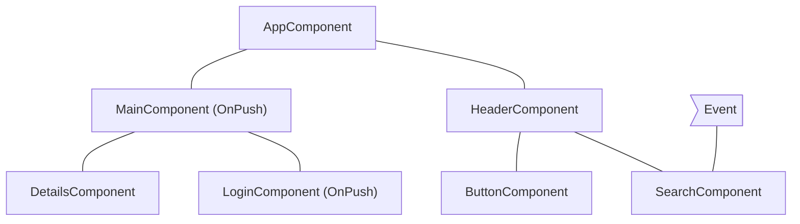
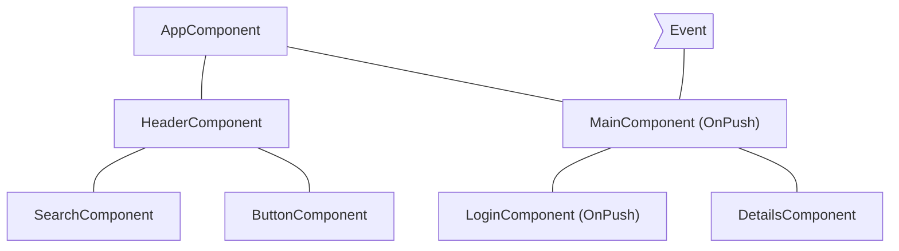
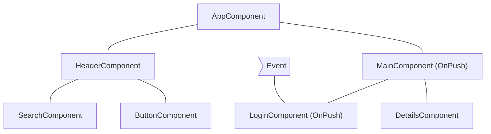
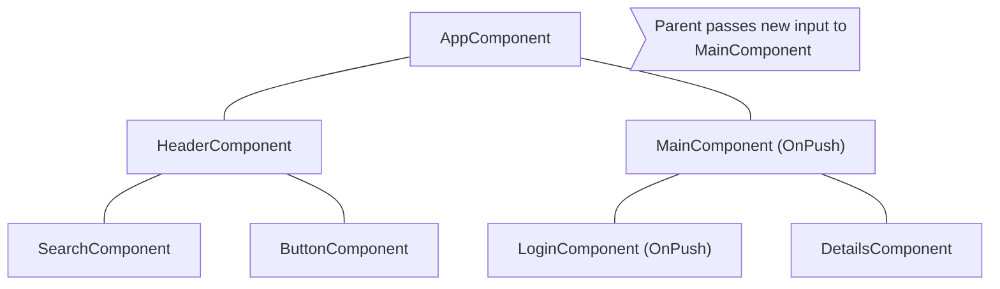

# 略過元件子樹

JavaScript 預設使用可變的資料結構，你可以從多個不同元件參考它們。Angular 會對你的整棵元件樹執行變更偵測，確保你的資料結構最新狀態有反映在 DOM 中。

對大多數應用程式而言，變更偵測已經夠快了。不過，當應用程式的元件樹特別龐大時，對整個應用程式執行變更偵測可能造成效能問題。你可以把變更偵測設定為只在元件樹的一部分上執行，來解決這個問題。

若你確定應用程式的某個部分不會受到狀態變更影響，你可以使用 [OnPush](/api/core/ChangeDetectionStrategy) 略過整個元件子樹的變更偵測。

## 使用 `OnPush` {#using-onpush}

OnPush 變更偵測指示 Angular **只在**下列情況下，才對某個元件子樹執行變更偵測：

- 子樹的根元件因為範本繫結而收到新的輸入。Angular 會用 `==` 比較輸入目前與先前的值。
- Angular 在子樹的根元件或其任何子元件中處理了事件_（例如使用事件繫結、輸出繫結，或 `@HostListener`）_，無論它們是否使用 OnPush 變更偵測都一樣。

你可以在 `@Component` 裝飾器中，把元件的變更偵測策略設為 `OnPush`：

```ts
import { ChangeDetectionStrategy, Component } from '@angular/core';
@Component({
  changeDetection: ChangeDetectionStrategy.OnPush,
})
export class MyComponent {}
```

## 常見的變更偵測情境

本節檢視幾個常見的變更偵測情境，說明 Angular 的行為。

### 事件由使用預設變更偵測的元件處理

若 Angular 在未使用 `OnPush` 策略的元件內處理事件，框架會對整棵元件樹執行變更偵測。Angular 會略過根元件使用 `OnPush`、且尚未收到新輸入的子元件樹。

舉例來說，若我們把 `MainComponent` 的變更偵測策略設為 `OnPush`，而使用者與根為 `MainComponent` 的子樹以外的元件互動，Angular 會檢查下圖中所有的粉紅色元件（`AppComponent`、`HeaderComponent`、`SearchComponent`、`ButtonComponent`），除非 `MainComponent` 收到新的輸入：



## 事件由使用 OnPush 的元件處理

若 Angular 在使用 OnPush 策略的元件內處理事件，框架會在整棵元件樹內執行變更偵測。Angular 會忽略根元件使用 OnPush、尚未收到新輸入，且位於處理事件的元件範圍之外的元件子樹。

舉例來說，若 Angular 在 `MainComponent` 內處理事件，框架會在整棵元件樹中執行變更偵測。Angular 會忽略以 `LoginComponent` 為根的子樹，因為它使用 `OnPush`，而且事件發生在它的範疇之外。



## 事件由使用 OnPush 元件的子代處理

若 Angular 在使用 OnPush 的元件中處理事件，框架會在整棵元件樹中執行變更偵測，包括該元件的祖先。

舉例來說，在下圖中，Angular 在使用 OnPush 的 `LoginComponent` 中處理事件。Angular 會在整個元件子樹中叫用變更偵測，包括 `MainComponent`（`LoginComponent` 的父元件），即使 `MainComponent` 也使用 `OnPush`。Angular 之所以也檢查 `MainComponent`，是因為 `LoginComponent` 是它的檢視的一部分。



## 傳給使用 OnPush 元件的新輸入

當範本繫結的結果設定了某個輸入屬性時，Angular 會在使用 `OnPush` 的子元件內執行變更偵測。

例如，在下圖中，`AppComponent` 把新輸入傳給使用 `OnPush` 的 `MainComponent`。Angular 會在 `MainComponent` 中執行變更偵測，但不會在同樣使用 `OnPush` 的 `LoginComponent` 中執行變更偵測，除非它也收到新的輸入。



## 邊界情況

- **在 TypeScript 程式碼中修改輸入屬性**。當你使用 `@ViewChild` 或 `@ContentChild` 之類的 API 在 TypeScript 中取得元件的參考，並手動修改 `@Input` 屬性時，Angular 不會自動為 OnPush 元件執行變更偵測。若你需要 Angular 執行變更偵測，可以在元件中注入 `ChangeDetectorRef`，並呼叫 `changeDetectorRef.markForCheck()`，告訴 Angular 排程一次變更偵測。
- **修改物件參考**。若某個輸入收到可變物件作為值，而你修改了物件卻保留同一個參考，Angular 不會叫用變更偵測。這是預期行為，因為該輸入先前與目前的值指向同一個參考。
