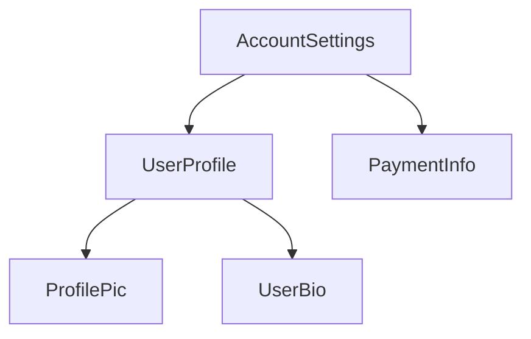

<docs-decorative-header title="元件的組成結構" imgSrc="adev/src/assets/images/components.svg"> <!-- markdownlint-disable-line -->
</docs-decorative-header>

Tip: 本指南假設你已讀過[基礎指南](essentials)。如果你是 Angular 新手，請先閱讀該指南。

每個元件都必須具備：

* 一個 TypeScript 類別，帶有各種_行為_，例如處理使用者輸入、從伺服器擷取資料
* 一個 HTML 範本，控制要算繪到 DOM 的內容
* 一個 [CSS 選擇器](https://developer.mozilla.org/en-US/docs/Learn/CSS/Building_blocks/Selectors)，定義元件在 HTML 中的使用方式

你可以在 TypeScript 類別上方加上 `@Component` [裝飾器](https://www.typescriptlang.org/docs/handbook/decorators.html)，為元件提供 Angular 專屬資訊：

<docs-code language="ts" highlight="[1, 2, 3, 4]">
@Component({
  selector: 'profile-photo',
  template: ``,
})
export class ProfilePhoto { }
</docs-code>

如需撰寫 Angular 範本的完整細節，請參閱[範本指南](guide/templates)。

傳給 `@Component` 裝飾器的物件稱為元件的**中繼資料**。它包括 `selector`、`template`，以及本指南各處所述的其他屬性。

元件可以選擇性地包含一份 CSS 樣式清單，套用到該元件的 DOM：

<docs-code language="ts" highlight="[4]">
@Component({
  selector: 'profile-photo',
  template: ``,
  styles: `img { border-radius: 50%; }`,
})
export class ProfilePhoto { }
</docs-code>

元件的樣式預設只會影響該元件範本中定義的元素。關於 Angular 的樣式處理方式，請參閱[元件樣式](guide/components/styling)。

你也可以選擇將範本與樣式寫在個別檔案中：

<docs-code language="ts" highlight="[3, 4]">
@Component({
  selector: 'profile-photo',
  templateUrl: 'profile-photo.html',
  styleUrl: 'profile-photo.css',
})
export class ProfilePhoto { }
</docs-code>

這樣有助於在專案中把_呈現_與_行為_的關注點分開。你可以為整個專案選定一種方式，也可以逐元件決定要使用哪一種。

`templateUrl` 與 `styleUrl` 都相對於元件所在的目錄。

## 使用元件

每個元件都會定義一個 [CSS 選擇器](https://developer.mozilla.org/en-US/docs/Learn/CSS/Building_blocks/Selectors)：

<docs-code language="ts" highlight="[2]">
@Component({
  selector: 'profile-photo',
  ...
})
export class ProfilePhoto { }
</docs-code>

關於 Angular 支援哪些類型的選擇器，以及如何選擇選擇器的指引，請參閱[元件選擇器](guide/components/selectors)。

你可以透過在_其他_元件的範本中建立相符的 HTML 元素，來使用某個元件：

<docs-code language="ts" highlight="[4]">
@Component({
  selector: 'user-profile',
  template: `
    <profile-photo />
    <button>Upload a new profile photo</button>`,
  ...,
})
export class UserProfile { }
</docs-code>

如需如何在範本中參照與使用其他元件的詳情，請參閱[匯入與使用元件](guide/components/importing)。

Angular 會為它遇到的每個相符 HTML 元素建立一個元件執行個體。與元件選擇器相符的 DOM 元素稱為該元件的**宿主元素**。元件範本的內容會算繪在其宿主元素內。

元件所算繪、對應其範本的 DOM，稱為該元件的**檢視**。

以這種方式組合元件時，**你可以把 Angular 應用程式想像成一棵元件樹**。

這種樹狀結構對於理解其他幾個 Angular 概念很重要，包括[依賴注入](guide/di)與[子查詢](guide/components/queries)。
