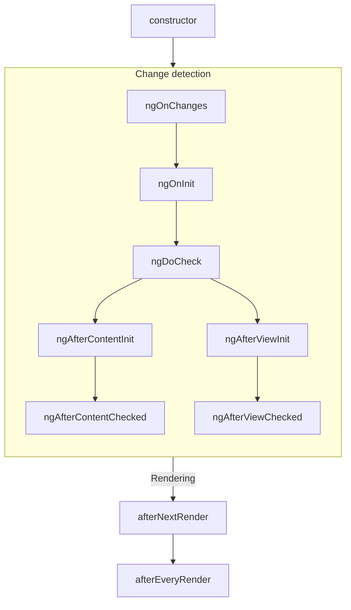
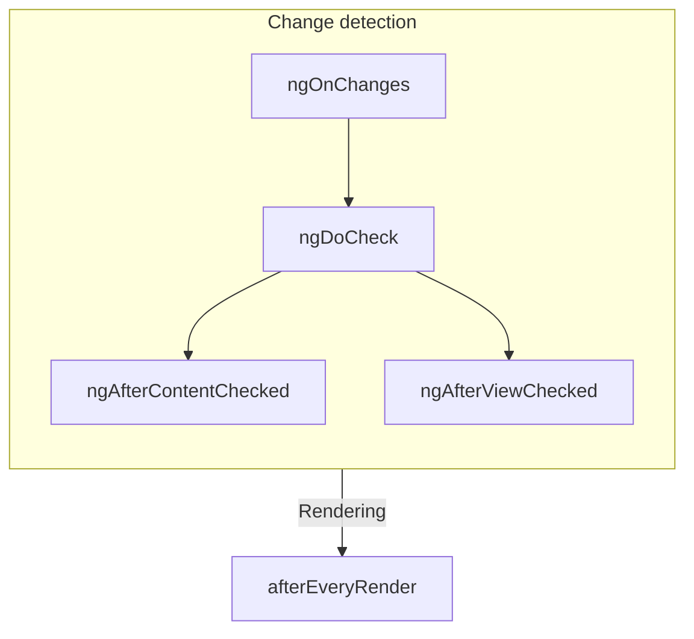

# 元件生命週期

TIP: 本指南假設你已讀過[基礎指南](essentials)。如果你是 Angular 新手，請先讀該指南。

元件的**生命週期**，是從元件建立到銷毀之間所經歷的一連串步驟。每個步驟代表 Angular 渲染元件、並隨時間檢查其更新的不同環節。

你可以在元件中實作**生命週期鉤子**，在這些步驟期間執行程式碼。與特定元件實例相關的生命週期鉤子，會以你元件類別上的方法來實作；與整個 Angular 應用程式相關的生命週期鉤子，則以接受回呼的函式形式實作。

元件的生命週期與 Angular 如何隨時間檢查元件的變更緊密相關。為了理解這個生命週期，你只需要知道：Angular 會由上而下走訪你的應用程式樹，檢查範本繫結是否有變更。以下說明的生命週期鉤子，會在 Angular 執行這趟走訪時運行。這趟走訪恰好造訪每個元件一次，因此你應避免在這個過程進行到一半時再更動狀態。

## 摘要

<div class="docs-table docs-scroll-track-transparent">
  <table>
    <tr>
      <td><strong>階段</strong></td>
      <td><strong>方法</strong></td>
      <td><strong>摘要</strong></td>
    </tr>
    <tr>
      <td>建立</td>
      <td><code>constructor</code></td>
      <td>
        <a href="https://developer.mozilla.org/docs/Web/JavaScript/Reference/Classes/constructor" target="_blank">
          標準 JavaScript 類別建構子
        </a>。在 Angular 具現化元件時執行。
      </td>
    </tr>
    <tr>
      <td rowspan="7">變更<br>偵測</td>
      <td><code>ngOnInit</code>
      </td>
      <td>在 Angular 初始化元件的所有 inputs 之後執行一次。</td>
    </tr>
    <tr>
      <td><code>ngOnChanges</code></td>
      <td>每當元件的 inputs 變更時執行。</td>
    </tr>
    <tr>
      <td><code>ngDoCheck</code></td>
      <td>每當檢查此元件是否有變更時執行。</td>
    </tr>
    <tr>
      <td><code>ngAfterContentInit</code></td>
      <td>在元件的 <em>content</em> 初始化之後執行一次。</td>
    </tr>
    <tr>
      <td><code>ngAfterContentChecked</code></td>
      <td>每當檢查此元件的內容是否有變更時執行。</td>
    </tr>
    <tr>
      <td><code>ngAfterViewInit</code></td>
      <td>在元件的 <em>view</em> 初始化之後執行一次。</td>
    </tr>
    <tr>
      <td><code>ngAfterViewChecked</code></td>
      <td>每當檢查元件的檢視是否有變更時執行。</td>
    </tr>
    <tr>
      <td rowspan="2">渲染</td>
      <td><code>afterNextRender</code></td>
      <td>在下一次<strong>所有</strong>元件都渲染至 DOM 時執行一次。</td>
    </tr>
    <tr>
      <td><code>afterEveryRender</code></td>
      <td>每當<strong>所有</strong>元件都渲染至 DOM 時執行。</td>
    </tr>
    <tr>
      <td>銷毀</td>
      <td><code>ngOnDestroy</code></td>
      <td>在元件銷毀前執行一次。</td>
    </tr>
  </table>
</div>

### ngOnInit

`ngOnInit` 方法會在 Angular 以初始值初始化元件的所有 inputs 之後執行。元件的 `ngOnInit` 恰好執行一次。

這個步驟發生在元件自身的範本初始化_之前_。這表示你可以依據元件 inputs 的初始值來更新元件的狀態。

### ngOnChanges

`ngOnChanges` 方法會在任何元件 inputs 變更之後執行。

這個步驟發生在檢查元件自身的範本_之前_。這表示你可以依據元件 inputs 的初始值來更新元件的狀態。

在初始化期間，第一個 `ngOnChanges` 會在 `ngOnInit` 之前執行。

#### 檢視變更

`ngOnChanges` 方法接受一個 `SimpleChanges` 引數。這個物件是一個 [`Record`](https://www.typescriptlang.org/docs/handbook/utility-types.html#recordkeys-type)，將每個元件 input 名稱對應到一個 `SimpleChange` 物件。每個 `SimpleChange` 都包含該 input 的前一個值、目前值，以及一個旗標，表示這是否為該 input 第一次變更。

你也可以選擇將目前的類別或 this 作為第一個泛型引數傳入，以獲得更嚴格的型別檢查。

```ts
@Component({/* ... */})
export class UserProfile {
  name = input('');

  ngOnChanges(changes: SimpleChanges<UserProfile>) {
    if (changes.name) {
      console.log(`Previous: ${changes.name.previousValue}`);
      console.log(`Current: ${changes.name.currentValue}`);
      console.log(`Is first ${changes.name.firstChange}`);
    }
  }
}
```

若你為任何 input 屬性提供了 `alias`，`SimpleChanges` 這個 Record 仍會以 TypeScript 屬性名稱作為鍵，而不是使用別名。

### ngOnDestroy

`ngOnDestroy` 方法會在元件銷毀前執行一次。當元件不再顯示於頁面上時，Angular 會銷毀該元件，例如被 `@if` 隱藏，或導覽至其他頁面時。

#### DestroyRef

除了 `ngOnDestroy` 方法之外，你也可以注入 `DestroyRef` 的一個實例。呼叫 `DestroyRef` 的 `onDestroy` 方法，即可註冊一個在元件銷毀時被呼叫的回呼。

```ts
@Component({/* ... */})
export class UserProfile {
  constructor() {
    inject(DestroyRef).onDestroy(() => {
      console.log('UserProfile destruction');
    });
  }
}
```

你可以將 `DestroyRef` 實例傳給元件之外的函式或類別。當元件銷毀時，若有其他程式碼需要執行某些清理行為，請使用這個模式。

你也可以使用 `DestroyRef`，讓設定程式碼靠近清理程式碼，而不必將所有清理程式碼都放在 `ngOnDestroy` 方法中。

##### 偵測實例銷毀

`DestroyRef` 提供了一個 `destroyed` 屬性，可用來檢查指定的實例是否已被銷毀。這在避免對已銷毀的元件進行操作時非常有用，特別是處理延遲或非同步邏輯時。

透過檢查 `destroyRef.destroyed`，你可以避免在實例清理完成後執行程式碼，從而避免如 `NG0911: View has already been destroyed.` 等潛在錯誤。

### ngDoCheck

`ngDoCheck` 方法會在 Angular 每次檢查元件範本是否有變更之前執行。

你可以使用這個生命週期鉤子，在 Angular 一般的變更偵測之外手動檢查狀態變更，並手動更新元件的狀態。

這個方法執行得非常頻繁，可能大幅影響頁面的效能。請盡可能避免定義這個鉤子，只在別無選擇時才使用。

在初始化期間，第一個 `ngDoCheck` 會在 `ngOnInit` 之後執行。

### ngAfterContentInit

`ngAfterContentInit` 方法會在巢狀置於元件內的所有子元素（其 _content_）初始化之後執行一次。

你可以使用這個生命週期鉤子來讀取[內容查詢](guide/components/queries#content-queries)的結果。雖然你可以存取這些查詢已初始化的狀態，但請避免更動某個祖先元件的範本已經渲染過的非訊號狀態。這麼做可能導致 [ExpressionChangedAfterItHasBeenCheckedError](errors/NG0100)。

### ngAfterContentChecked

`ngAfterContentChecked` 方法會在巢狀置於元件內的所有子元素（其 _content_）檢查完變更之後，每次都執行。

這個方法執行得非常頻繁，可能大幅影響頁面的效能。請盡可能避免定義這個鉤子，只在別無選擇時才使用。

雖然你可以在這裡存取[內容查詢](guide/components/queries#content-queries)的更新後狀態，但請避免更動某個祖先元件的範本已經渲染過的非訊號狀態。這麼做可能導致 [ExpressionChangedAfterItHasBeenCheckedError](errors/NG0100)。

### ngAfterViewInit

`ngAfterViewInit` 方法會在元件範本中的所有子元素（其 _view_）初始化之後執行一次。

你可以使用這個生命週期鉤子來讀取[檢視查詢](guide/components/queries#view-queries)的結果。雖然你可以存取這些查詢已初始化的狀態，但請避免更動某個範本已經渲染過的非訊號狀態。這麼做可能導致 [ExpressionChangedAfterItHasBeenCheckedError](errors/NG0100)。

### ngAfterViewChecked

`ngAfterViewChecked` 方法會在元件範本中的所有子元素（其 _view_）檢查完變更之後，每次都執行。

這個方法執行得非常頻繁，可能大幅影響頁面的效能。請盡可能避免定義這個鉤子，只在別無選擇時才使用。

雖然你可以在這裡存取[檢視查詢](guide/components/queries#view-queries)的更新後狀態，但請避免更動某個範本已經渲染過的非訊號狀態。這麼做可能導致 [ExpressionChangedAfterItHasBeenCheckedError](errors/NG0100)。

### afterEveryRender 與 afterNextRender

`afterEveryRender` 與 `afterNextRender` 函式可讓你註冊一個**渲染回呼**，在 Angular 完成將頁面上的_所有元件_渲染至 DOM 之後被呼叫。

這些函式與本指南中說明的其他生命週期鉤子不同。它們不是類別方法，而是接受回呼的獨立函式。渲染回呼的執行並不綁定任何特定的元件實例，而是應用程式層級的鉤子。

`afterEveryRender` 與 `afterNextRender` 必須在[注入情境](guide/di/dependency-injection-context)中呼叫，通常是在元件的建構子中。

你可以使用渲染回呼來執行手動的 DOM 操作。關於在 Angular 中處理 DOM 的指引，請參閱[使用 DOM API](guide/components/dom-apis)。

渲染回呼不會在伺服器端渲染或建置時預渲染期間執行。

#### after\*Render 的階段

使用 `afterEveryRender` 或 `afterNextRender` 時，你可以選擇將工作拆分為多個階段。階段讓你能控制 DOM 操作的先後順序，例如將_寫入_操作排在_讀取_操作之前，以盡量減少[版面抖動](https://web.dev/avoid-large-complex-layouts-and-layout-thrashing)。為了在階段之間溝通，階段函式可以傳回一個結果值，供下一個階段存取。

```ts
import {Component, ElementRef, afterNextRender, inject} from '@angular/core';

@Component(/* ... */)
export class UserProfile {
  private prevPadding = 0;
  private elementHeight = 0;

  constructor() {
    const elementRef = inject(ElementRef);
    const nativeElement = elementRef.nativeElement;

    afterNextRender({
      // Use the `Write` phase to write to a geometric property.
      write: () => {
        const padding = computePadding();
        const changed = padding !== this.prevPadding;
        if (changed) {
          nativeElement.style.padding = padding;
        }
        return changed; // Communicate whether anything changed to the read phase.
      },

      // Use the `Read` phase to read geometric properties after all writes have occurred.
      read: (didWrite) => {
        if (didWrite) {
          this.elementHeight = nativeElement.getBoundingClientRect().height;
        }
      },
    });
  }
}
```

共有四個階段，依以下順序執行：

| 階段             | 說明                                                                                                                                                                                           |
| ---------------- | ----------------------------------------------------------------------------------------------------------------------------------------------------------------------------------------------------- |
| `earlyRead`      | 使用此階段讀取任何會影響版面、且後續計算嚴格需要的 DOM 屬性與樣式。請盡可能避免使用此階段，優先使用 `write` 與 `read` 階段。 |
| `write`          | 使用此階段寫入會影響版面的 DOM 屬性與樣式。                                                                                                                                   |
| `mixedReadWrite` | 預設階段。用於需要同時讀取與寫入會影響版面的屬性與樣式的操作。請盡可能避免使用此階段，優先使用明確的 `write` 與 `read` 階段。            |
| `read`           | 使用此階段讀取任何會影響版面的 DOM 屬性。                                                                                                                                           |

## 生命週期介面

Angular 為每個生命週期方法提供了一個 TypeScript 介面。你可以選擇匯入並 `implement` 這些介面，確保你的實作沒有錯字或拼寫錯誤。

每個介面的名稱都與對應的方法相同，但不含 `ng` 前綴。例如，`ngOnInit` 的介面是 `OnInit`。

```ts
@Component({/* ... */})
export class UserProfile implements OnInit {
  ngOnInit() {
    /* ... */
  }
}
```

## 執行順序

以下圖表顯示 Angular 生命週期鉤子的執行順序。

### 初始化期間



### 後續更新



### 與指令的順序關係

當你在與元件相同的元素上放置一個或多個指令時，無論是在範本中還是透過 `hostDirectives` 屬性，框架都不保證在同一個元素上，某個生命週期鉤子在元件與指令之間的執行順序。切勿依賴觀察到的順序，因為這在 Angular 的後續版本中可能會改變。
