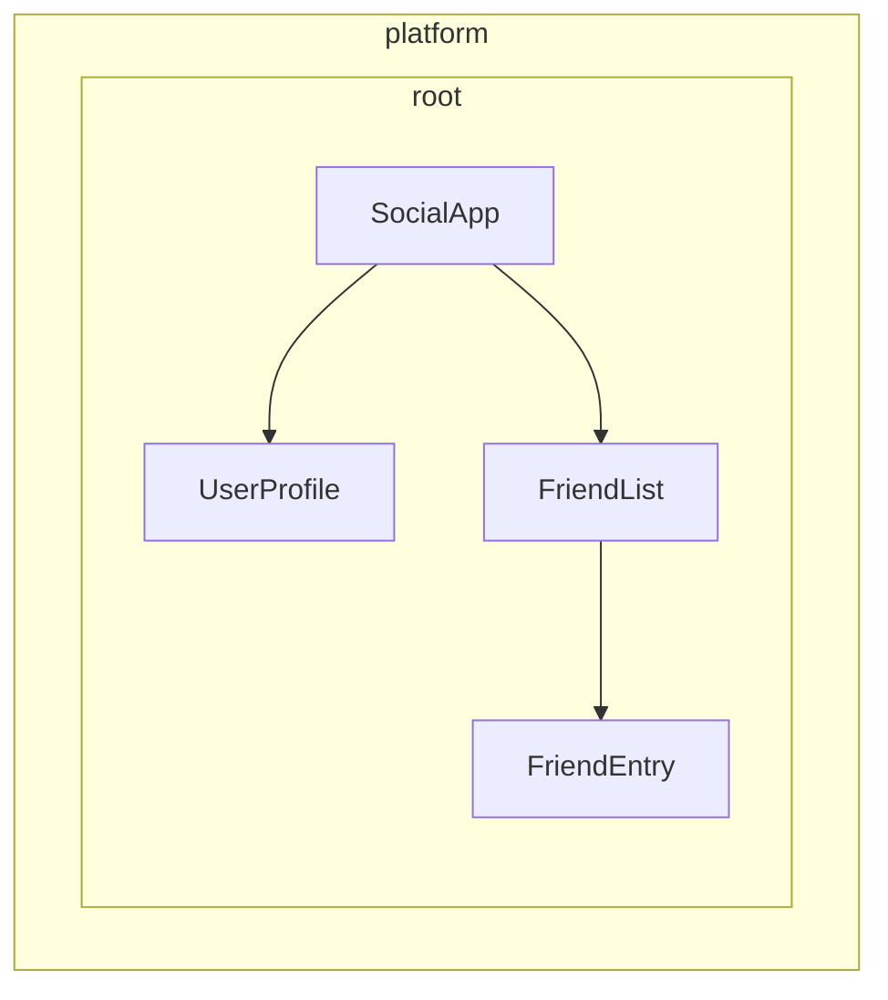

# 定義依賴提供者

Angular 提供兩種方式，讓服務可供注入：

1. **自動提供**：使用 `@Injectable` 裝飾器中的 `providedIn`、[`@Service`](guide/di/creating-and-using-services#using-the-service-vs-injectable-decorator) 裝飾器，或在 `InjectionToken` 設定中提供工廠
2. **手動提供**：使用元件、指令、路由或應用程式設定中的 `providers` 陣列

在[上一篇指南](/guide/di/creating-and-using-services)中，你學到了如何使用 `providedIn: 'root'` 建立服務，這涵蓋了最常見的使用情境。本指南將探討自動與手動提供者設定的其他模式。

## 非類別依賴的自動提供

帶有 `providedIn: 'root'` 的 `@Injectable` 裝飾器對服務（類別）很好用，但你可能需要全域提供其他類型的值，例如設定物件、函式或原始值。Angular 為此提供了 `InjectionToken`。

### 什麼是 InjectionToken？ {#what-is-an-injectiontoken}

`InjectionToken` 是 Angular 依賴注入系統用來唯一識別可注入值的物件。可以把它想成一把特殊的鑰匙，讓你能在 Angular 的 DI 系統中儲存和擷取任何類型的值：

```ts
import {InjectionToken} from '@angular/core';

// Create a token for a string value
export const API_URL = new InjectionToken<string>('api.url');

// Create a token for a function
export const LOGGER = new InjectionToken<(msg: string) => void>('logger.function');

// Create a token for a complex type
export interface Config {
  apiUrl: string;
  timeout: number;
}
export const CONFIG_TOKEN = new InjectionToken<Config>('app.config');
```

NOTE: 字串參數（例如 `'api.url'`）只是一個純粹用於除錯的描述，Angular 是以物件參考來識別 token，而不是這個字串。

### 搭配 `providedIn: 'root'` 的 InjectionToken

帶有 `factory` 的 `InjectionToken`，預設即為 `providedIn: 'root'`（但可以透過 `providedIn` 屬性覆寫）。

```ts {header: "/app/config.token.ts"}
import {InjectionToken, Component, inject} from '@angular/core';

export interface AppConfig {
  apiUrl: string;
  version: string;
  features: Record<string, boolean>;
}

// Globally available configuration using providedIn
export const APP_CONFIG = new InjectionToken<AppConfig>('app.config', {
  providedIn: 'root',
  factory: () => ({
    apiUrl: 'https://api.example.com',
    version: '1.0.0',
    features: {
      darkMode: true,
      analytics: false,
    },
  }),
});

// No need to add to providers array - available everywhere!
@Component({
  selector: 'app-header',
  template: `<h1>Version: {{ config.version }}</h1>`,
})
export class Header {
  config = inject(APP_CONFIG); // Automatically available
}
```

### 何時該使用帶工廠函式的 InjectionToken

當你無法使用類別、但需要全域提供依賴時，帶工廠函式的 InjectionToken 是理想選擇：

```ts {header: "/app/logger.token.ts"}
import {InjectionToken, inject} from '@angular/core';
import {APP_CONFIG} from './config.token';

// Logger function type
export type LoggerFn = (level: 'log' | 'warn' | 'error', message: string) => void;

// Global logger function with dependencies
export const LOGGER_FN = new InjectionToken<LoggerFn>('logger.function', {
  providedIn: 'root',
  factory: () => {
    const config = inject(APP_CONFIG);

    return (level: 'log' | 'warn' | 'error', message: string) => {
      if (config.features.logging !== false) {
        console[level](`[${new Date().toISOString()}] ${message}`);
      }
    };
  },
});
```

```ts {header: "/app/storage.token.ts"}
// Providing browser APIs as tokens
export const LOCAL_STORAGE = new InjectionToken<Storage>('localStorage', {
  // providedIn: 'root' is configured as the default
  factory: () => window.localStorage,
});

export const SESSION_STORAGE = new InjectionToken<Storage>('sessionStorage', {
  providedIn: 'root',
  factory: () => window.sessionStorage,
});
```

```ts {header: "/app/feature-flags.token.ts"}
// Complex configuration with runtime logic
export const FEATURE_FLAGS = new InjectionToken<Map<string, boolean>>('feature.flags', {
  providedIn: 'root',
  factory: () => {
    const flags = new Map<string, boolean>();

    // Parse from environment or URL params
    const urlParams = new URLSearchParams(window.location.search);
    const enableBeta = urlParams.get('beta') === 'true';

    flags.set('betaFeatures', enableBeta);
    flags.set('darkMode', true);
    flags.set('newDashboard', false);

    return flags;
  },
});
```

這種做法有幾個優點：

- **不需要手動設定提供者**：運作方式就像服務的 `providedIn: 'root'` 一樣
- **可搖樹**：只有在實際被使用時才會包含進來
- **型別安全**：對非類別值提供完整的 TypeScript 支援
- **可以注入其他依賴**：工廠函式可以使用 `inject()` 來存取其他服務

## 了解手動提供者設定

當你需要比 `providedIn: 'root'` 更強的控制時，可以手動設定提供者。在以下情況，透過 `providers` 陣列手動設定很有用：

1. **服務沒有 `providedIn`**：沒有自動提供的服務必須手動提供
2. **你想要新的實例**：在元件／指令層級建立獨立的實例，而不是用共用的那個
3. **你需要執行階段設定**：當服務行為取決於執行階段的值時
4. **你提供的是非類別值**：設定物件、函式或原始值

### 範例：沒有 `providedIn` 的服務

```ts
import {Injectable, Component, inject} from '@angular/core';

// Service without providedIn
@Injectable()
export class LocalDataStore {
  private data: string[] = [];

  addData(item: string) {
    this.data.push(item);
  }
}

// Component must provide it
@Component({
  selector: 'app-example',
  // A provider is required here because the `LocalDataStore` service has no providedIn.
  providers: [LocalDataStore],
  template: `...`,
})
export class Example {
  dataStore = inject(LocalDataStore);
}
```

### 範例：建立元件專屬的實例

帶有 `providedIn: 'root'` 的服務可以在元件層級被覆寫。這會把服務實例與元件的生命週期綁在一起。因此，當元件被銷毀時，所提供的服務也會一併被銷毀。

```ts
import {Injectable, Component, inject} from '@angular/core';

@Injectable({providedIn: 'root'})
export class DataStore {
  private data: string[] = [];
}

// This component gets its own instance
@Component({
  selector: 'app-isolated',
  // Creates new instance of `DataStore` rather than using the root-provided instance.
  providers: [DataStore],
  template: `...`,
})
export class Isolated {
  dataStore = inject(DataStore); // Component-specific instance
}
```

## Angular 中的注入器階層 {#injector-hierarchy-in-angular}

Angular 的依賴注入系統是階層式的。當元件請求某個依賴時，Angular 會從該元件的注入器開始，沿著樹往上尋找，直到找到該依賴的提供者為止。應用程式樹中的每個元件都可以有自己的注入器，這些注入器形成一個與元件樹相對應的階層。

這個階層帶來以下能力：

- **限定範圍的實例**：應用程式的不同部分可以擁有同一個服務的不同實例
- **覆寫行為**：子元件可以覆寫父元件的提供者
- **記憶體效率**：服務只在需要的地方被實例化

在 Angular 中，任何帶有元件或指令的元素，都可以把值提供給它的所有後代。



在上面的範例中：

1. `SocialApp` 可以把值提供給 `UserProfile` 和 `FriendList`
2. `FriendList` 可以把值提供給 `FriendEntry` 注入，但無法提供給 `UserProfile` 注入，因為它不在同一棵樹中

## 宣告提供者

可以把 Angular 的依賴注入系統想成雜湊表或字典。每個提供者設定物件都定義了一組鍵值對：

- **鍵**（提供者識別項）：你用來請求依賴的唯一識別項
- **值**：當該 token 被請求時，Angular 應該傳回的內容

手動提供依賴時，你通常會看到這種簡寫語法：

```angular-ts
import {Component} from '@angular/core';
import {LocalService} from './local-service';

@Component({
  selector: 'app-example',
  providers: [LocalService], // Service without providedIn
})
export class Example {}
```

這其實是一種更詳細的提供者設定的簡寫：

```ts
{
  // This is the shorthand version
  providers: [LocalService],

  // This is the full version
  providers: [
    { provide: LocalService, useClass: LocalService }
  ]
}
```

### 提供者設定物件

每個提供者設定物件都有兩個主要部分：

1. **提供者識別項**：Angular 用來取得依賴的唯一鍵（透過 `provide` 屬性設定）
2. **值**：你想讓 Angular 取得的實際依賴，依所需的類型用不同的鍵來設定：
   - `useClass`：提供一個 JavaScript 類別
   - `useValue`：提供一個靜態值
   - `useFactory`：提供一個傳回值的工廠函式
   - `useExisting`：提供一個既有提供者的別名

### 提供者識別項

提供者識別項讓 Angular 的依賴注入（DI）系統能透過唯一 ID 擷取依賴。你可以用兩種方式產生提供者識別項：

1. [類別名稱](#class-names)
2. [Injection token](#injection-tokens)

#### 類別名稱 {#class-names}

類別名稱直接使用匯入的類別作為識別項：

```angular-ts
import {Component} from '@angular/core';
import {LocalService} from './local-service';

@Component({
  selector: 'app-example',
  providers: [{provide: LocalService, useClass: LocalService}],
})
export class Example {
  /* ... */
}
```

類別同時充當識別項和實作，這就是 Angular 提供 `providers: [LocalService]` 這種簡寫的原因。

#### Injection token {#injection-tokens}

Angular 提供內建的 [`InjectionToken`](api/core/InjectionToken) 類別，用來為可注入的值建立唯一的物件參考，或在你想為同一個介面提供多個實作時使用。

```ts {header: "/app/tokens.ts"}
import {InjectionToken} from '@angular/core';
import {DataService} from './data-service.interface';

export const DATA_SERVICE_TOKEN = new InjectionToken<DataService>('DataService');
```

NOTE: 字串 `'DataService'` 只是一個純粹用於除錯的描述。Angular 是以物件參考來識別 token，而不是這個字串。

在你的提供者設定中使用這個 token：

```angular-ts
import {Component, inject} from '@angular/core';
import {LocalDataService} from './local-data-service';
import {DATA_SERVICE_TOKEN} from './tokens';

@Component({
  selector: 'app-example',
  providers: [{provide: DATA_SERVICE_TOKEN, useClass: LocalDataService}],
})
export class Example {
  private dataService = inject(DATA_SERVICE_TOKEN);
}
```

#### TypeScript 介面可以作為注入的識別項嗎？

TypeScript 介面無法用於注入，因為它們在執行階段並不存在：

```ts
// ❌ This won't work!
interface DataService {
  getData(): string[];
}

// Interfaces disappear after TypeScript compilation
@Component({
  providers: [
    {provide: DataService, useClass: LocalDataService}, // Error!
  ],
})
export class Example {
  private dataService = inject(DataService); // Error!
}

// ✅ Use InjectionToken instead
export const DATA_SERVICE_TOKEN = new InjectionToken<DataService>('DataService');

@Component({
  providers: [{provide: DATA_SERVICE_TOKEN, useClass: LocalDataService}],
})
export class Example {
  private dataService = inject(DATA_SERVICE_TOKEN); // Works!
}
```

InjectionToken 提供了一個 Angular DI 系統可以在執行階段使用的值，同時透過 TypeScript 的泛型型別參數維持型別安全。

### 提供者值的類型

#### useClass

`useClass` 把一個 JavaScript 類別提供為依賴。使用簡寫語法時，這是預設行為：

```ts
// Shorthand
providers: [DataService];

// Full syntax
providers: [{provide: DataService, useClass: DataService}];

// Different implementation
providers: [{provide: DataService, useClass: MockDataService}];

// Conditional implementation
providers: [
  {
    provide: StorageService,
    useClass: environment.production ? CloudStorageService : LocalStorageService,
  },
];
```

#### 實務範例：替換 Logger

你可以替換實作來擴充功能：

```ts
import {Injectable, Component, inject} from '@angular/core';

// Base logger
@Injectable()
export class Logger {
  log(message: string) {
    console.log(message);
  }
}

// Enhanced logger with timestamp
@Injectable()
export class BetterLogger extends Logger {
  override log(message: string) {
    super.log(`[${new Date().toISOString()}] ${message}`);
  }
}

// Logger that includes user context
@Injectable()
export class EvenBetterLogger extends Logger {
  private userService = inject(UserService);

  override log(message: string) {
    const name = this.userService.user.name;
    super.log(`Message to ${name}: ${message}`);
  }
}

// In your component
@Component({
  selector: 'app-example',
  providers: [
    UserService, // EvenBetterLogger needs this
    {provide: Logger, useClass: EvenBetterLogger},
  ],
})
export class Example {
  private logger = inject(Logger); // Gets EvenBetterLogger instance
}
```

#### useValue

`useValue` 把任何 JavaScript 資料型別提供為靜態值：

```ts
providers: [
  {provide: API_URL_TOKEN, useValue: 'https://api.example.com'},
  {provide: MAX_RETRIES_TOKEN, useValue: 3},
  {provide: FEATURE_FLAGS_TOKEN, useValue: {darkMode: true, beta: false}},
];
```

IMPORTANT: TypeScript 型別和介面不能作為依賴值。它們只存在於編譯時期。

#### 實務範例：應用程式設定

`useValue` 的一個常見使用情境是提供應用程式設定：

```ts
// Define configuration interface
export interface AppConfig {
  apiUrl: string;
  appTitle: string;
  features: {
    darkMode: boolean;
    analytics: boolean;
  };
}

// Create injection token
export const APP_CONFIG = new InjectionToken<AppConfig>('app.config');

// Define configuration
const appConfig: AppConfig = {
  apiUrl: 'https://api.example.com',
  appTitle: 'My Application',
  features: {
    darkMode: true,
    analytics: false,
  },
};

// Provide in bootstrap
bootstrapApplication(AppComponent, {
  providers: [{provide: APP_CONFIG, useValue: appConfig}],
});

// Use in component
@Component({
  selector: 'app-header',
  template: `<h1>{{ title }}</h1>`,
})
export class Header {
  private config = inject(APP_CONFIG);
  title = this.config.appTitle;
}
```

#### useFactory

`useFactory` 提供一個函式，用來產生供注入的新值：

```ts
export const loggerFactory = (config: AppConfig) => {
  return new LoggerService(config.logLevel, config.endpoint);
};

providers: [
  {
    provide: LoggerService,
    useFactory: loggerFactory,
    deps: [APP_CONFIG], // Dependencies for the factory function
  },
];
```

你可以把工廠的依賴標記為可選：

```ts
import {Optional} from '@angular/core';

providers: [
  {
    provide: MyService,
    useFactory: (required: RequiredService, optional?: OptionalService) => {
      return new MyService(required, optional || new DefaultService());
    },
    deps: [RequiredService, [new Optional(), OptionalService]],
  },
];
```

#### 實務範例：以設定為基礎的 API 用戶端

以下是一個完整範例，示範如何使用工廠來建立帶有執行階段設定的服務：

```ts
// Service that needs runtime configuration
class ApiClient {
  constructor(
    private http: HttpClient,
    private baseUrl: string,
    private rateLimitMs: number,
  ) {}

  async fetchData(endpoint: string) {
    // Apply rate limiting based on user tier
    await this.applyRateLimit();
    return this.http.get(`${this.baseUrl}/${endpoint}`);
  }

  private async applyRateLimit() {
    // Simplified example - real implementation would track request timing
    return new Promise((resolve) => setTimeout(resolve, this.rateLimitMs));
  }
}

// Factory function that configures based on user tier
import {inject, Component} from '@angular/core';
import {HttpClient} from '@angular/common/http';
const apiClientFactory = () => {
  const http = inject(HttpClient);
  const userService = inject(UserService);

  // Assuming userService provides these values
  const baseUrl = userService.getApiBaseUrl();
  const rateLimitMs = userService.getRateLimit();

  return new ApiClient(http, baseUrl, rateLimitMs);
};

// Provider configuration
export const apiClientProvider = {
  provide: ApiClient,
  useFactory: apiClientFactory,
};

// Usage in component
@Component({
  selector: 'app-dashboard',
  providers: [apiClientProvider],
})
export class Dashboard {
  private apiClient = inject(ApiClient);
}
```

#### useExisting

`useExisting` 為已經定義的提供者建立別名。兩個 token 都會傳回同一個實例：

```ts
providers: [
  NewLogger, // The actual service
  {provide: OldLogger, useExisting: NewLogger}, // The alias
];
```

IMPORTANT: 不要把 `useExisting` 和 `useClass` 混淆。`useClass` 會建立各自獨立的實例，而 `useExisting` 確保你取得的是同一個單例實例。

### 多重提供者

當多個提供者要為同一個 token 貢獻值時，使用 `multi: true` 旗標：

```ts
export const INTERCEPTOR_TOKEN = new InjectionToken<Interceptor[]>('interceptors');

providers: [
  {provide: INTERCEPTOR_TOKEN, useClass: AuthInterceptor, multi: true},
  {provide: INTERCEPTOR_TOKEN, useClass: LoggingInterceptor, multi: true},
  {provide: INTERCEPTOR_TOKEN, useClass: RetryInterceptor, multi: true},
];
```

當你注入 `INTERCEPTOR_TOKEN` 時，你會收到一個陣列，其中包含全部三個攔截器的實例。

## 你可以在哪些地方指定提供者？

Angular 提供多個可以註冊提供者的層級，每個層級對範圍、生命週期和效能都有不同的影響：

- [**應用程式啟動**](#application-bootstrap)：隨處可用的全域單例
- [**在元素上**（元件或指令）](#component-or-directive-providers)：特定元件樹的隔離實例
- [**路由**](#route-providers)：延遲載入模組的功能專屬服務

### 應用程式啟動 {#application-bootstrap}

在以下情況，把應用程式層級的提供者放在 `bootstrapApplication` 中：

- **服務跨多個功能區域使用**：例如 HTTP 用戶端、記錄或驗證等應用程式許多部分都需要的服務
- **你想要真正的單例**：由整個應用程式共用的一個實例
- **服務沒有元件專屬的設定**：在任何地方運作方式都相同的通用工具
- **你提供的是全域設定**：API 端點、功能旗標或環境設定

```ts {header: "main.ts"}
bootstrapApplication(App, {
  providers: [
    {provide: API_BASE_URL, useValue: 'https://api.example.com'},
    {provide: INTERCEPTOR_TOKEN, useClass: AuthInterceptor, multi: true},
    LoggingService, // Used throughout the app
    {provide: ErrorHandler, useClass: GlobalErrorHandler},
  ],
});
```

**優點**：

- 單一實例可減少記憶體用量
- 隨處可用，不需要額外設定
- 更容易管理全域狀態

**缺點**：

- 永遠會包含在你的 JavaScript bundle 中，即使該值從未被注入
- 無法輕易地依功能客製化
- 較難單獨測試個別元件

#### 為什麼要在啟動時提供，而不是使用 `providedIn: 'root'`？

在以下情況，你可能會想在啟動時提供提供者：

- 提供者有副作用（例如安裝用戶端路由器）
- 提供者需要設定（例如路由）
- 你使用的是 Angular 的 `provideSomething` 模式（例如 `provideRouter`、`provideHttpClient`）

### 元件或指令提供者 {#component-or-directive-providers}

在以下情況，使用元件或指令提供者：

- **服務有元件專屬的狀態**：表單驗證器、元件專屬的快取或 UI 狀態管理器
- **你需要隔離的實例**：每個元件需要自己的服務副本
- **服務只被一棵元件樹使用**：不需要全域存取的專門服務
- **你在建立可重複使用的元件**：應該能以自己的服務獨立運作的元件

```angular-ts
// Specialized form component with its own validation service
@Component({
  selector: 'app-advanced-form',
  providers: [
    FormValidationService, // Each form gets its own validator
    {provide: FORM_CONFIG, useValue: {strictMode: true}},
  ],
})
export class AdvancedForm {}

// Modal component with isolated state management
@Component({
  selector: 'app-modal',
  providers: [
    ModalStateService, // Each modal manages its own state
  ],
})
export class Modal {}
```

**優點**：

- 更好的封裝與隔離
- 更容易單獨測試元件
- 多個實例可以以不同設定共存

**缺點**：

- 每個元件都會建立新實例（記憶體用量較高）
- 元件之間沒有共用狀態
- 需要在每個需要的地方提供
- 永遠會和元件或指令包含在同一個 JavaScript bundle 中，即使該值從未被注入

NOTE: 如果同一個元素上的多個指令提供了同一個 token，其中一個會勝出，但哪一個會勝出並未定義。

### 路由提供者 {#route-providers}

路由層級的提供者適用於：

- **功能專屬的服務**：只在特定路由或功能模組中需要的服務
- **延遲載入模組的依賴**：應該只隨特定功能一起載入的服務
- **路由專屬的設定**：依應用程式區域而不同的設定

```ts {header: "routes.ts"}
export const routes: Routes = [
  {
    path: 'admin',
    providers: [
      AdminService, // Only loaded with admin routes
      {provide: FEATURE_FLAGS, useValue: {adminMode: true}},
    ],
    loadChildren: () => import('./admin/admin.routes'),
  },
  {
    path: 'shop',
    providers: [
      ShoppingCartService, // Isolated shopping state
      PaymentService,
    ],
    loadChildren: () => import('./shop/shop.routes'),
  },
];
```

在路由層級提供的服務，可供該路由內的所有元件和指令使用，也可供它的守衛和解析器使用。

由於這些服務是在路由的元件之外獨立實例化的，它們無法直接存取路由專屬的資訊。

## 函式庫作者模式

建立 Angular 函式庫時，你經常需要為使用者提供彈性的設定選項，同時維持乾淨的 API。Angular 自己的函式庫就示範了達成此目標的強大模式。

### `provide` 模式

函式庫作者可以匯出傳回提供者設定的函式，而不是要求使用者手動設定複雜的提供者：

```ts {header: "/libs/analytics/src/providers.ts"}
import {InjectionToken, Provider, inject} from '@angular/core';

// Configuration interface
export interface AnalyticsConfig {
  trackingId: string;
  enableDebugMode?: boolean;
  anonymizeIp?: boolean;
}

// Internal token for configuration
const ANALYTICS_CONFIG = new InjectionToken<AnalyticsConfig>('analytics.config');

// Main service that uses the configuration
export class AnalyticsService {
  private config = inject(ANALYTICS_CONFIG);

  track(event: string, properties?: any) {
    // Implementation using config
  }
}

// Provider function for consumers
export function provideAnalytics(config: AnalyticsConfig): Provider[] {
  return [{provide: ANALYTICS_CONFIG, useValue: config}, AnalyticsService];
}
```

```ts {header: "main.ts"}
// Usage in consumer app
bootstrapApplication(App, {
  providers: [
    provideAnalytics({
      trackingId: 'GA-12345',
      enableDebugMode: !environment.production,
    }),
  ],
});
```

### 帶選項的進階提供者模式

對於更複雜的情境，你可以結合多種設定方式：

```ts {header: "/libs/http-client/src/provider.ts"}
import {Provider, InjectionToken, inject} from '@angular/core';
import {bootstrapApplication} from '@angular/platform-browser';

// Feature flags for optional functionality
export enum HttpFeatures {
  Interceptors = 'interceptors',
  Caching = 'caching',
  Retry = 'retry',
}

// Configuration interfaces
export interface HttpConfig {
  baseUrl?: string;
  timeout?: number;
  headers?: Record<string, string>;
}

export interface RetryConfig {
  maxAttempts: number;
  delayMs: number;
}

// Internal tokens
const HTTP_CONFIG = new InjectionToken<HttpConfig>('http.config');
const RETRY_CONFIG = new InjectionToken<RetryConfig>('retry.config');
const HTTP_FEATURES = new InjectionToken<Set<HttpFeatures>>('http.features');

// Core service
class HttpClientService {
  private config = inject(HTTP_CONFIG, {optional: true});
  private features = inject(HTTP_FEATURES);

  get(url: string) {
    // Use config and check features
  }
}

// Feature services
class RetryInterceptor {
  private config = inject(RETRY_CONFIG);
  // Retry logic
}

class CacheInterceptor {
  // Caching logic
}

// Main provider function
export function provideHttpClient(config?: HttpConfig, ...features: HttpFeature[]): Provider[] {
  const providers: Provider[] = [
    {provide: HTTP_CONFIG, useValue: config || {}},
    {provide: HTTP_FEATURES, useValue: new Set(features.map((f) => f.kind))},
    HttpClientService,
  ];

  // Add feature-specific providers
  features.forEach((feature) => {
    providers.push(...feature.providers);
  });

  return providers;
}

// Feature configuration functions
export interface HttpFeature {
  kind: HttpFeatures;
  providers: Provider[];
}

export function withInterceptors(...interceptors: any[]): HttpFeature {
  return {
    kind: HttpFeatures.Interceptors,
    providers: interceptors.map((interceptor) => ({
      provide: INTERCEPTOR_TOKEN,
      useClass: interceptor,
      multi: true,
    })),
  };
}

export function withCaching(): HttpFeature {
  return {
    kind: HttpFeatures.Caching,
    providers: [CacheInterceptor],
  };
}

export function withRetry(config: RetryConfig): HttpFeature {
  return {
    kind: HttpFeatures.Retry,
    providers: [{provide: RETRY_CONFIG, useValue: config}, RetryInterceptor],
  };
}

// Consumer usage with multiple features
bootstrapApplication(App, {
  providers: [
    provideHttpClient(
      {baseUrl: 'https://api.example.com'},
      withInterceptors(AuthInterceptor, LoggingInterceptor),
      withCaching(),
      withRetry({maxAttempts: 3, delayMs: 1000}),
    ),
  ],
});
```

### 為什麼要用提供者函式，而不是直接設定？

提供者函式為函式庫作者帶來幾個優點：

1. **封裝**：內部 token 和實作細節保持私密
2. **型別安全**：TypeScript 確保編譯時期的設定正確
3. **彈性**：用 `with*` 模式輕鬆組合功能
4. **面向未來**：內部實作可以變更，而不會破壞使用者的程式
5. **一致性**：與 Angular 自己的模式一致（例如 `provideRouter`、`provideHttpClient` 等）

這個模式在 Angular 自己的函式庫中被廣泛使用，被視為需要提供可設定服務的函式庫作者的最佳實務。
