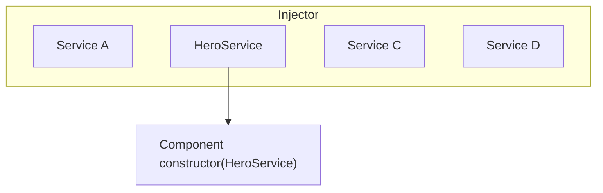

# 了解依賴注入

依賴注入（DI）是 Angular 的基本概念之一。DI 已內建於 Angular 框架中，讓帶有 Angular 裝飾器的類別（例如元件、指令、管道與可注入物件）能設定它們所需的依賴。

DI 系統中有兩個主要角色：依賴消費者與依賴提供者。

Angular 使用一種稱為 `Injector` 的抽象，來促進依賴消費者與依賴提供者之間的互動。當某個依賴被請求時，注入器會檢查它的註冊表，看其中是否已有可用的實例。如果沒有，就會建立一個新實例並存入註冊表。Angular 會在應用程式啟動過程中，建立一個應用程式範圍的注入器（也稱為「根」注入器）。在大多數情況下，你不需要手動建立注入器，但你應該知道，有一個層次負責連接提供者與消費者。

本主題涵蓋類別如何作為依賴的基本情境。Angular 也允許你使用函式、物件、原始型別（例如字串或布林值），或任何其他型別作為依賴。更多資訊請參閱[依賴提供者](guide/di/dependency-injection-providers)。

## 提供依賴 {#providing-a-dependency}

假設有一個名為 `HeroService` 的類別，需要在元件中作為依賴。

第一步是加上 `@Injectable` 裝飾器，表明該類別可以被注入。

<docs-code language="typescript" highlight="[1]">
@Injectable()
class HeroService {}
</docs-code>

下一步是透過提供它，讓它在 DI 中可供使用。
依賴可以在多個地方提供：

* [**首選**：在應用程式根層級使用 `providedIn`。](#preferred-at-the-application-root-level-using-providedin)
* [在元件層級。](#at-the-component-level)
* [在應用程式根層級使用 `ApplicationConfig`。](#at-the-application-root-level-using-applicationconfig)
* [以 `NgModule` 為基礎的應用程式。](#ngmodule-based-applications)

### **首選**：在應用程式根層級使用 `providedIn` {#preferred-at-the-application-root-level-using-providedin}

在應用程式根層級使用 `providedIn` 提供服務，可將該服務注入到所有其他類別中。
使用 `providedIn` 能讓 Angular 與 JavaScript 程式碼最佳化工具，有效移除未使用的服務（即搖樹優化）。

你可以在 `@Injectable` 裝飾器中使用 `providedIn: 'root'` 來提供服務：

<docs-code language="typescript" highlight="[2]">
@Injectable({
  providedIn: 'root'
})
class HeroService {}
</docs-code>

當你在根層級提供服務時，Angular 會建立一個 `HeroService` 的單一共用實例，並將它注入到任何請求它的類別中。

### 在元件層級 {#at-the-component-level}

你可以使用 `@Component` 裝飾器的 `providers` 欄位，在 `@Component` 層級提供服務。
在這種情況下，`HeroService` 可供這個元件的所有實例，以及範本中使用的其他元件和指令使用。

例如：

<docs-code language="typescript" highlight="[5]">
@Component({
  standalone: true,
  selector: 'hero-list',
  template: '...',
  providers: [HeroService]
})
class HeroListComponent {}
</docs-code>

當你在元件層級註冊提供者時，該元件的每個新實例都會取得一個新的服務實例。

Note: 以這種方式宣告服務，會讓 `HeroService` 永遠包含在你的應用程式中——即使該服務未被使用。

### 在應用程式根層級使用 `ApplicationConfig` {#at-the-application-root-level-using-applicationconfig}

你可以使用 `ApplicationConfig` 的 `providers` 欄位（傳入 `bootstrapApplication` 函式），在應用程式層級提供服務或其他 `Injectable`。

在以下範例中，`HeroService` 可供所有元件、指令和管道使用：

<docs-code language="typescript" highlight="[3]">
export const appConfig: ApplicationConfig = {
    providers: [
      { provide: HeroService },
    ]
};
</docs-code>

接著，在 `main.ts` 中：

<docs-code language="typescript">
bootstrapApplication(AppComponent, appConfig)
</docs-code>

Note: 以這種方式宣告服務，會讓 `HeroService` 永遠包含在你的應用程式中——即使該服務未被使用。

### 以 `NgModule` 為基礎的應用程式 {#ngmodule-based-applications}

以 `@NgModule` 為基礎的應用程式，使用 `@NgModule` 裝飾器的 `providers` 欄位，在應用程式層級提供服務或其他 `Injectable`。

在模組中提供的服務，可供該模組的所有宣告使用，或供共用同一個 `ModuleInjector` 的任何其他模組使用。
若要了解所有邊界情況，請參閱[階層式注入器](guide/di/hierarchical-dependency-injection)。

Note: 使用 `providers` 宣告服務，會讓該服務被包含在你的應用程式中——即使該服務未被使用。

## 注入/取用依賴 {#injectingconsuming-a-dependency}

最常見的注入依賴方式，是在類別建構子中宣告它。當 Angular 建立元件、指令或管道類別的新實例時，它會查看建構子參數的型別，來判斷該類別需要哪些服務或其他依賴。例如，若 `HeroListComponent` 需要 `HeroService`，建構子可以寫成這樣：

<docs-code language="typescript" highlight="[3]">
@Component({ … })
class HeroListComponent {
  constructor(private service: HeroService) {}
}
</docs-code>

另一個選項是使用 [inject](api/core/inject) 方法：

<docs-code language="typescript" highlight="[3]">
@Component({ … })
class HeroListComponent {
  private service = inject(HeroService);
}
</docs-code>

當 Angular 發現某個元件依賴某個服務時，它會先檢查注入器中是否已有該服務的現有實例。如果請求的服務實例尚不存在，注入器會使用已註冊的提供者建立一個，並將它加入注入器，然後再把服務傳回給 Angular。

當所有請求的服務都已解析並傳回後，Angular 就能以這些服務作為引數，呼叫元件的建構子。

## 後續步驟 {#whats-next}

<docs-pill-row>
  <docs-pill href="/guide/di/creating-injectable-service" title="建立可注入的服務"/>
</docs-pill-row>
