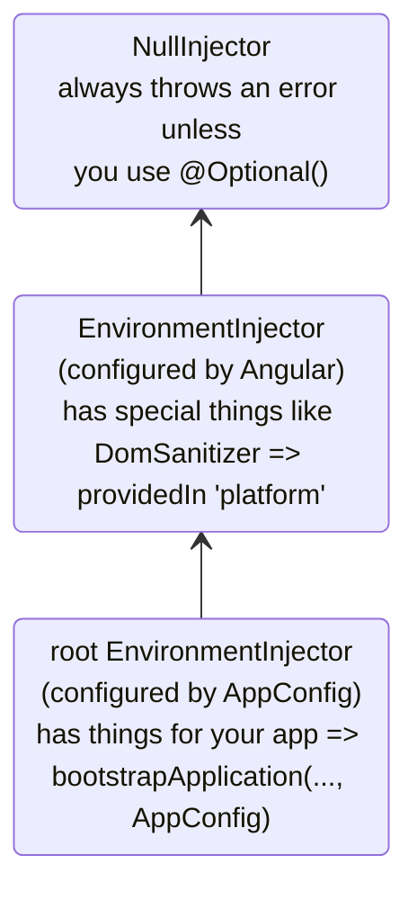
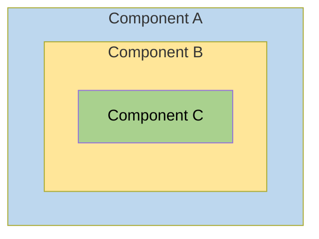
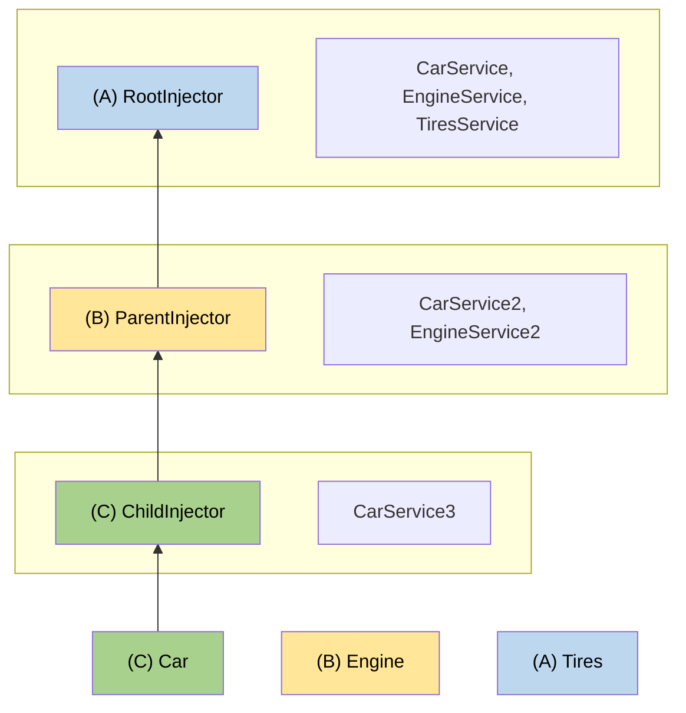

# 階層式注入器

本指南深入說明 Angular 的階層式依賴注入系統，包括解析規則、修飾符和進階模式。

NOTE: 關於注入器階層和提供者範圍的基本概念，請參閱[定義依賴提供者指南](guide/di/defining-dependency-providers#injector-hierarchy-in-angular)。

## 注入器階層的類型

Angular 有兩種注入器階層：

| 注入器階層                      | 詳細資訊                                                                                                                                                                  |
| :------------------------------ | :------------------------------------------------------------------------------------------------------------------------------------------------------------------------ |
| `EnvironmentInjector` 階層      | 使用 `@Service()` 或 `ApplicationConfig` 中的 `providers` 陣列，在此階層中設定 `EnvironmentInjector`。                                                                    |
| `ElementInjector` 階層          | 在每個 DOM 元素上隱含地建立。`ElementInjector` 預設是空的，除非你在 `@Directive()` 或 `@Component()` 的 `providers` 屬性中設定它。                                       |

<docs-callout title="以 NgModule 為基礎的應用程式">
對於以 `NgModule` 為基礎的應用程式，你可以使用 `@NgModule()` 或 `@Injectable()` 註記，透過 `ModuleInjector` 階層提供依賴。
</docs-callout>

### `EnvironmentInjector`

`EnvironmentInjector` 可以用以下兩種方式之一來設定：

- `@Service()`
- `ApplicationConfig` 的 `providers` 陣列

<docs-callout title="搖樹優化與 @Service()">

使用 `@Service()` 裝飾器比使用 `ApplicationConfig` 的 `providers` 陣列更可取。有了 `@Service`，最佳化工具可以執行搖樹優化，移除你的應用程式沒有使用的服務。如此能產生更小的 bundle。

搖樹優化對函式庫特別有用，因為使用該函式庫的應用程式可能不需要注入它。

</docs-callout>

`EnvironmentInjector` 由 `ApplicationConfig.providers` 設定。

使用 `@Service()` 提供服務的方式如下：

```ts {highlight:[4]}
import {Service} from '@angular/core';

@Service() // <--provides this service in the root EnvironmentInjector
export class ItemService {
  name = 'telephone';
}
```

`@Service()` 或 `@Injectable()` 裝飾器用來標識服務類別。

### ModuleInjector

對於以 `NgModule` 為基礎的應用程式，ModuleInjector 可以用以下兩種方式之一來設定：

- `@Service()` 裝飾器，
- 以 `@Injectable()` 的 `providedIn` 屬性指向 `root` 或 `platform`
- `@NgModule()` 的 `providers` 陣列

`ModuleInjector` 由 `@NgModule.providers` 和 `NgModule.imports` 屬性設定。`ModuleInjector` 是沿著 `NgModule.imports` 遞迴追蹤可觸及的所有 providers 陣列攤平後的結果。

延遲載入其他 `@NgModules` 時，會建立子 `ModuleInjector` 階層。

### 平台注入器

在 `root` 之上還有兩個注入器：一個額外的 `EnvironmentInjector` 和 `NullInjector()`。

想想 Angular 如何以 `main.ts` 中的以下程式碼啟動應用程式：

```ts
bootstrapApplication(App, appConfig);
```

`bootstrapApplication()` 方法會建立平台注入器的一個子注入器，它由 `ApplicationConfig` 實例設定。
這就是 `root` `EnvironmentInjector`。

`bootstrapApplication()` 方法也會建立（或重複使用）平台注入器，其中包含平台專屬的依賴。
這讓多個應用程式可以共用一個平台設定。
例如，無論你執行多少個應用程式，瀏覽器都只有一個網址列。
你可以使用 `platformBrowser()` 函式提供 `extraProviders`，在平台層級設定額外的平台專屬提供者。

階層中再往上的父注入器是 `NullInjector()`，它是這棵樹的頂端。
如果你沿著樹一路往上、最後在 `NullInjector()` 中尋找服務，你會收到一個錯誤，除非你使用了 `@Optional()`，因為最終一切都結束於 `NullInjector()`，它會傳回錯誤，或在 `@Optional()` 的情況下傳回 `null`。
關於 `@Optional()` 的更多資訊，請參閱本指南的 [`@Optional()` 一節](#optional)。

下圖呈現了 `root` `ModuleInjector` 與其父注入器之間的關係，如前幾段所述。



雖然 `root` 這個名稱是一個特殊的別名，其他 `EnvironmentInjector` 階層沒有別名。
你可以在動態載入元件建立時建立 `EnvironmentInjector` 階層，例如透過 Router，它會建立子 `EnvironmentInjector` 階層。

所有請求都會向上轉送到根注入器，無論你是用傳給 `bootstrapApplication()` 方法的 `ApplicationConfig` 實例來設定它，或是在各個服務本身以 `root` 註冊所有提供者。

<docs-callout title="@Injectable() 與 ApplicationConfig">

如果你在 `bootstrapApplication` 的 `ApplicationConfig` 中設定了一個全應用程式的提供者，它會覆寫在 `@Injectable()` 詮釋資料中為 `root` 設定的提供者。
你可以這樣做，來為一個與多個應用程式共用的服務設定非預設的提供者。

以下是一個範例：元件路由設定把非預設的[位置策略](guide/routing/common-router-tasks#locationstrategy-and-browser-url-styles)提供者列在 `ApplicationConfig` 的 `providers` 清單中。

```ts
providers: [{provide: LocationStrategy, useClass: HashLocationStrategy}];
```

對於以 `NgModule` 為基礎的應用程式，請在 `AppModule` 的 `providers` 中設定全應用程式的提供者。

</docs-callout>

### `ElementInjector`

Angular 會為每個 DOM 元素隱含地建立 `ElementInjector` 階層。

在 `@Component()` 裝飾器中使用它的 `providers` 或 `viewProviders` 屬性提供服務，就能設定一個 `ElementInjector`。
例如，以下 `TestComponent` 透過如下方式提供服務來設定 `ElementInjector`：

```ts {highlight:[3]}
@Component({
  /* … */
  providers: [{ provide: ItemService, useValue: { name: 'lamp' } }]
})
export class TestComponent
```

HELPFUL: 請參閱[解析規則](#resolution-rules)一節，了解 `EnvironmentInjector` 樹、`ModuleInjector` 和 `ElementInjector` 樹之間的關係。

當你在元件中提供服務時，該服務透過該元件實例的 `ElementInjector` 可供使用。
根據[解析規則](#resolution-rules)一節所述的可見性規則，它在子元件／指令中也可能可見。

當元件實例被銷毀時，該服務實例也會一併被銷毀。

#### `@Directive()` 與 `@Component()`

元件是指令的一種特殊類型，意思是就像 `@Directive()` 有 `providers` 屬性一樣，`@Component()` 也有。
這表示指令和元件都可以使用 `providers` 屬性來設定提供者。
當你使用 `providers` 屬性為元件或指令設定提供者時，該提供者屬於該元件或指令的 `ElementInjector`。
同一個元素上的元件和指令共用一個注入器。

## 解析規則

為元件／指令解析 token 時，Angular 會分兩個階段進行：

1. 對照它在 `ElementInjector` 階層中的父層。
2. 對照它在 `EnvironmentInjector` 階層中的父層。

當元件宣告一個依賴時，Angular 會試圖用它自己的 `ElementInjector` 來滿足該依賴。
如果元件的注入器缺少該提供者，它會把請求往上傳給父元件的 `ElementInjector`。

請求會不斷向上轉送，直到 Angular 找到能處理該請求的注入器，或用盡所有祖先 `ElementInjector` 階層為止。

如果 Angular 在任何 `ElementInjector` 階層中都找不到該提供者，它會回到請求發出的元素，並在 `EnvironmentInjector` 階層中尋找。
如果 Angular 仍然找不到該提供者，它就會擲出錯誤。

如果你在不同層級為同一個 DI token 註冊了提供者，Angular 遇到的第一個就是它用來解析該依賴的提供者。
例如，如果提供者在需要某個服務的元件中就地註冊，
Angular 就不會再尋找同一個服務的其他提供者。

HELPFUL: 對於以 `NgModule` 為基礎的應用程式，如果 Angular 在 `ElementInjector` 階層中找不到提供者，它會搜尋 `ModuleInjector` 階層。

## 解析修飾符

Angular 的解析行為可以用 `optional`、`self`、`skipSelf` 和 `host` 來修改。
從 `@angular/core` 匯入它們，並在你注入服務時，在 [`inject`](/api/core/inject) 設定中使用它們。

### 修飾符的類型

解析修飾符分為三類：

- 找不到你要找的東西時該怎麼做，也就是 `optional`
- 從哪裡開始找，也就是 `skipSelf`
- 在哪裡停止尋找，也就是 `host` 和 `self`

依預設，Angular 一律從目前的 `Injector` 開始，一路往上搜尋。
修飾符讓你可以改變開始（也就是 *self*）的位置和結束的位置。

此外，你可以組合所有修飾符，但以下組合除外：

- `host` 和 `self`
- `skipSelf` 和 `self`。

### `optional`

`optional` 讓 Angular 把你注入的服務視為可選。
這樣一來，如果它在執行階段無法被解析，Angular 會把該服務解析為 `null`，而不是擲出錯誤。
在以下範例中，服務 `OptionalService` 沒有在服務、`ApplicationConfig`、`@NgModule()` 或元件類別中被提供，因此它在應用程式的任何地方都不可用。

```ts {header:"src/app/optional/optional.ts"}
export class Optional {
  public optional? = inject(OptionalService, {optional: true});
}
```

### `self`

使用 `self`，讓 Angular 只查看目前元件或指令的 `ElementInjector`。

`self` 的一個很好的使用情境是注入一個服務，但前提是它在目前的宿主元素上可用。
為了在這種情況下避免錯誤，把 `self` 與 `optional` 組合使用。

例如，在以下的 `SelfNoData` 中，注意作為屬性的被注入的 `LeafService`。

```ts {header: 'self-no-data.ts', highlight: [7]}
@Component({
  selector: 'app-self-no-data',
  templateUrl: './self-no-data.html',
  styleUrls: ['./self-no-data.css'],
})
export class SelfNoData {
  public leaf = inject(LeafService, {optional: true, self: true});
}
```

在這個範例中，存在一個父提供者，注入該服務會傳回該值；然而，以 `self` 和 `optional` 注入該服務會傳回 `null`，因為 `self` 告訴注入器在目前的宿主元素就停止搜尋。

另一個範例顯示帶有 `FlowerService` 提供者的元件類別。
在這種情況下，注入器不需要再往別處尋找，因為它在目前的 `ElementInjector` 中就找到了 `FlowerService`，並傳回鬱金香 🌷。

```ts {header:"src/app/self/self.ts"}
@Component({
  selector: 'app-self',
  templateUrl: './self.html',
  styleUrls: ['./self.css'],
  providers: [{provide: FlowerService, useValue: {emoji: '🌷'}}],
})
export class Self {
  public flower = inject(FlowerService, {self: true});
}
```

### `skipSelf`

`skipSelf` 是 `self` 的相反。
有了 `skipSelf`，Angular 會從父 `ElementInjector` 開始搜尋服務，而不是從目前的注入器開始。
因此，如果父 `ElementInjector` 為 `emoji` 使用的是蕨類 <code>🌿</code> 的值，但你在元件的 `providers` 陣列中有楓葉 <code>🍁</code>，Angular 會忽略楓葉 <code>🍁</code>，改用蕨類 <code>🌿</code>。

要在程式碼中看這一點，假設父元件使用的是以下的 `emoji` 值，如同這個服務：

```ts {header: 'leaf.service.ts'}
export class LeafService {
  emoji = '🌿';
}
```

想像在子元件中，你有一個不同的值，楓葉 🍁，但你想改用父元件的值。
這時你就會用 `skipSelf`：

```ts {header:"skipself.ts" highlight:[[6],[10]]}
@Component({
  selector: 'app-skipself',
  templateUrl: './skipself.html',
  styleUrls: ['./skipself.css'],
  // Angular would ignore this LeafService instance
  providers: [{provide: LeafService, useValue: {emoji: '🍁'}}],
})
export class Skipself {
  // Use skipSelf as inject option
  public leaf = inject(LeafService, {skipSelf: true});
}
```

在這種情況下，你為 `emoji` 取得的值會是蕨類 <code>🌿</code>，而不是楓葉 <code>🍁</code>。

#### `skipSelf` 選項搭配 `optional`

把 `skipSelf` 選項與 `optional` 一起使用，可以在值為 `null` 時避免錯誤。

在以下範例中，`Person` 服務在屬性初始化期間被注入。
`skipSelf` 告訴 Angular 跳過目前的注入器，而 `optional` 會在 `Person` 服務為 `null` 時避免錯誤。

```ts
class Person {
  parent = inject(Person, {optional: true, skipSelf: true});
}
```

### `host`

<!-- TODO: Remove ambiguity between host and self. -->

`host` 讓你在搜尋提供者時，把某個元件指定為注入器樹中的最後一站。

即使樹的更上方還有服務實例，Angular 也不會繼續尋找。
`host` 的使用方式如下：

```ts {header:"host.ts" highlight:[[6],[9]]}
@Component({
  selector: 'app-host',
  templateUrl: './host.html',
  styleUrls: ['./host.css'],
  // provide the service
  providers: [{provide: FlowerService, useValue: {emoji: '🌷'}}],
})
export class Host {
  // use host when injecting the service
  flower = inject(FlowerService, {host: true, optional: true});
}
```

由於 `Host` 有 `host` 選項，無論 `Host` 的父層的 `flower.emoji` 值是什麼，`Host` 都會使用鬱金香 <code>🌷</code>。

### 建構子注入的修飾符

如同先前所呈現的，建構子注入的行為可以用 `@Optional()`、`@Self()`、`@SkipSelf()` 和 `@Host()` 來修改。

從 `@angular/core` 匯入它們，並在你注入服務時，在元件類別的建構子中使用它們。

```ts {header:"self-no-data.ts" highlight:[2]}
export class SelfNoData {
  constructor(@Self() @Optional() public leaf?: LeafService) {}
}
```

## 範本的邏輯結構

當你在元件類別中提供服務時，服務在 `ElementInjector` 樹中的可見性，取決於你提供這些服務的位置和方式。

了解 Angular 範本底層的邏輯結構，能為你設定服務、進而控制它們的可見性打下基礎。

元件在你的範本中被使用，如以下範例：

```html
<app-root> <app-child />; </app-root>
```

HELPFUL: 通常，你會把元件和它們的範本宣告在不同的檔案中。
為了理解注入系統如何運作，從合併後的邏輯樹的角度來看它們會很有幫助。
*邏輯*一詞是為了把它與算繪樹區分開來，算繪樹就是你的應用程式的 DOM 樹。
為了標記元件範本所在的位置，本指南使用 `<#VIEW>` 虛擬元素，它實際上並不存在於算繪樹中，只是為了心智模型而存在。

以下是一個範例，示範 `<app-root>` 和 `<app-child>` 的檢視樹如何合併成單一的邏輯樹：

```html
<app-root>
  <#VIEW>
    <app-child>
     <#VIEW>
       …content goes here…
     </#VIEW>
    </app-child>
  </#VIEW>
</app-root>
```

了解 `<#VIEW>` 分界的概念，在你於元件類別中設定服務時尤其重要。

## 範例：在 `@Component()` 中提供服務

你使用 `@Component()`（或 `@Directive()`）裝飾器提供服務的方式，決定了它們的可見性。
以下各節示範 `providers` 和 `viewProviders`，以及用 `skipSelf` 和 `host` 修改服務可見性的方法。

元件類別可以用兩種方式提供服務：

| 陣列                         | 詳細資訊                                       |
| :--------------------------- | :--------------------------------------------- |
| 使用 `providers` 陣列        | `@Component({ providers: [SomeService] })`     |
| 使用 `viewProviders` 陣列    | `@Component({ viewProviders: [SomeService] })` |

在以下範例中，你會看到一個 Angular 應用程式的邏輯樹。
為了說明注入器在範本脈絡中如何運作，邏輯樹將呈現應用程式的 HTML 結構。
例如，邏輯樹會顯示 `<child-component>` 是 `<parent-component>` 的直接子元素。

在邏輯樹中，你會看到特殊屬性：`@Provide`、`@Inject` 和 `@ApplicationConfig`。
這些不是真正的屬性，而是用來示範底層發生了什麼。

| Angular 服務屬性          | 詳細資訊                                                                                 |
| :------------------------ | :--------------------------------------------------------------------------------------- |
| `@Inject(Token)=>Value`   | 如果 `Token` 在邏輯樹的這個位置被注入，它的值會是 `Value`。                              |
| `@Provide(Token=Value)`   | 表示 `Token` 在邏輯樹的這個位置以 `Value` 被提供。                                       |
| `@ApplicationConfig`      | 示範在此位置應該使用備用的 `EnvironmentInjector`。                                       |

### 範例應用程式結構

範例應用程式有一個在 `root` 提供的 `FlowerService`，其 `emoji` 值為紅色扶桑花 <code>🌺</code>。

```ts {header:"flower.service.ts"}
@Service()
export class FlowerService {
  emoji = '🌺';
}
```

設想一個只有 `App` 和 `Child` 的應用程式。
最基本的算繪檢視會像以下這樣巢狀的 HTML 元素：

```html
<app-root>
  <!-- App selector -->
  <app-child> <!-- Child selector --> </app-child>
</app-root>
```

然而，在幕後，Angular 在解析注入請求時使用如下的邏輯檢視表示法：

```html
<app-root> <!-- App selector -->
  <#VIEW>
    <app-child> <!-- Child selector -->
      <#VIEW>
      </#VIEW>
    </app-child>
  </#VIEW>
</app-root>
```

這裡的 `<#VIEW>` 代表一個範本的實例。
注意每個元件都有自己的 `<#VIEW>`。

了解這個結構能幫助你決定如何提供和注入服務，並讓你完全掌控服務的可見性。

現在，設想 `<app-root>` 注入了 `FlowerService`：

```typescript
export class App {
  flower = inject(FlowerService);
}
```

在 `<app-root>` 範本中加入一個繫結，來視覺化結果：

```html
<p>Emoji from FlowerService: {{flower.emoji}}</p>
```

The output in the view would be:

```text {hideCopy}
Emoji from FlowerService: 🌺
```

In the logical tree, this would be represented as follows:

```html
<app-root @ApplicationConfig
        @Inject(FlowerService) flower=>"🌺">
  <#VIEW>
    <p>Emoji from FlowerService: {{flower.emoji}} (🌺)</p>
    <app-child>
      <#VIEW>
      </#VIEW>
    </app-child>
  </#VIEW>
</app-root>
```

When `<app-root>` requests the `FlowerService`, it is the injector's job to resolve the `FlowerService` token.
The resolution of the token happens in two phases:

1. The injector determines the starting location in the logical tree and an ending location of the search.
   The injector begins with the starting location and looks for the token at each view level in the logical tree.
   If the token is found it is returned.

1. If the token is not found, the injector looks for the closest parent `EnvironmentInjector` to delegate the request to.

In the example case, the constraints are:

1. Start with `<#VIEW>` belonging to `<app-root>` and end with `<app-root>`.
   - Normally the starting point for search is at the point of injection.
     However, in this case `<app-root>` is a component. `@Component`s are special in that they also include their own `viewProviders`, which is why the search starts at `<#VIEW>` belonging to `<app-root>`.
     This would not be the case for a directive matched at the same location.
   - The ending location happens to be the same as the component itself, because it is the topmost component in this application.

1. The `EnvironmentInjector` provided by the `ApplicationConfig` acts as the fallback injector when the injection token can't be found in the `ElementInjector` hierarchies.

### Using the `providers` array

Now, in the `Child` class, add a provider for `FlowerService` to demonstrate more complex resolution rules in the upcoming sections:

```ts
@Component({
  selector: 'app-child',
  templateUrl: './child.html',
  styleUrls: ['./child.css'],
  // use the providers array to provide a service
  providers: [{provide: FlowerService, useValue: {emoji: '🌻'}}],
})
export class Child {
  // inject the service
  flower = inject(FlowerService);
}
```

Now that the `FlowerService` is provided in the `@Component()` decorator, when the `<app-child>` requests the service, the injector has only to look as far as the `ElementInjector` in the `<app-child>`.
It won't have to continue the search any further through the injector tree.

The next step is to add a binding to the `Child` template.

```html
<p>Emoji from FlowerService: {{flower.emoji}}</p>
```

To render the new values, add `<app-child>` to the bottom of the `App` template so the view also displays the sunflower:

```text {hideCopy}
Child Component
Emoji from FlowerService: 🌻
```

In the logical tree, this is represented as follows:

```html
<app-root @ApplicationConfig
          @Inject(FlowerService) flower=>"🌺">
  <#VIEW>

  <p>Emoji from FlowerService: {{flower.emoji}} (🌺)</p>
  <app-child @Provide(FlowerService="🌻" )
             @Inject(FlowerService)=>"🌻"> <!-- search ends here -->
    <#VIEW> <!-- search starts here -->
    <h2>Child Component</h2>
    <p>Emoji from FlowerService: {{flower.emoji}} (🌻)</p>
  </
  #VIEW>
  </app-child>
</#VIEW>
</app-root>
```

When `<app-child>` requests the `FlowerService`, the injector begins its search at the `<#VIEW>` belonging to `<app-child>` \(`<#VIEW>` is included because it is injected from `@Component()`\) and ends with `<app-child>`.
In this case, the `FlowerService` is resolved in the `providers` array with sunflower <code>🌻</code> of the `<app-child>`.
The injector doesn't have to look any further in the injector tree.
It stops as soon as it finds the `FlowerService` and never sees the red hibiscus <code>🌺</code>.

### Using the `viewProviders` array

Use the `viewProviders` array as another way to provide services in the `@Component()` decorator.
Using `viewProviders` makes services visible in the `<#VIEW>`.

HELPFUL: The steps are the same as using the `providers` array, with the exception of using the `viewProviders` array instead.

For step-by-step instructions, continue with this section.
If you can set it up on your own, skip ahead to [Modifying service availability](#visibility-of-provided-tokens).

For demonstration, we are building an `AnimalService` to demonstrate `viewProviders`.
First, create an `AnimalService` with an `emoji` property of whale <code>🐳</code>:

```typescript
import {Service} from '@angular/core';

@Service()
export class AnimalService {
  emoji = '🐳';
}
```

Following the same pattern as with the `FlowerService`, inject the `AnimalService` in the `App` class:

```ts
export class App {
  public flower = inject(FlowerService);
  public animal = inject(AnimalService);
}
```

HELPFUL: You can leave all the `FlowerService` related code in place as it will allow a comparison with the `AnimalService`.

Add a `viewProviders` array and inject the `AnimalService` in the `<app-child>` class, too, but give `emoji` a different value.
Here, it has a value of dog 🐶.

```typescript
@Component({
  selector: 'app-child',
  templateUrl: './child.html',
  styleUrls: ['./child.css'],
  // provide services
  providers: [{provide: FlowerService, useValue: {emoji: '🌻'}}],
  viewProviders: [{provide: AnimalService, useValue: {emoji: '🐶'}}],
})
export class Child {
  // inject services
  flower = inject(FlowerService);
  animal = inject(AnimalService);
}
```

Add bindings to the `Child` and the `App` templates.
In the `Child` template, add the following binding:

```html
<p>Emoji from AnimalService: {{animal.emoji}}</p>
```

Additionally, add the same to the `App` template:

```html
<p>Emoji from AnimalService: {{animal.emoji}}</p>
```

Now you should see both values in the browser:

```text {hideCopy}
App
Emoji from AnimalService: 🐳

Child Component
Emoji from AnimalService: 🐶
```

The logic tree for this example of `viewProviders` is as follows:

```html
<app-root @ApplicationConfig
          @Inject(AnimalService) animal=>"🐳">
  <#VIEW>
  <app-child>
    <#VIEW @Provide(AnimalService="🐶")
    @Inject(AnimalService=>"🐶")>

    <!-- ^^using viewProviders means AnimalService is available in <#VIEW>-->
    <p>Emoji from AnimalService: {{animal.emoji}} (🐶)</p>
  </
  #VIEW>
  </app-child>
</#VIEW>
</app-root>
```

Just as with the `FlowerService` example, the `AnimalService` is provided in the `<app-child>` `@Component()` decorator.
This means that since the injector first looks in the `ElementInjector` of the component, it finds the `AnimalService` value of dog <code>🐶</code>.
It doesn't need to continue searching the `ElementInjector` tree, nor does it need to search the `ModuleInjector`.

### `providers` vs. `viewProviders`

The `viewProviders` field is conceptually similar to `providers`, but there is one notable difference.
Providers in `viewProviders` are only visible inside the component's own view — content projected into the component via `<ng-content>` cannot see them.

To see the difference between using `providers` and `viewProviders`, add another component to the example and call it `Inspector`.
`Inspector` will be a child of the `Child`.
In `inspector.ts`, inject the `FlowerService` and `AnimalService` during property initialization:

```typescript
export class Inspector {
  flower = inject(FlowerService);
  animal = inject(AnimalService);
}
```

You do not need a `providers` or `viewProviders` array.
Next, in `inspector.html`, add the same markup from previous components:

```html
<p>Emoji from FlowerService: {{flower.emoji}}</p>
<p>Emoji from AnimalService: {{animal.emoji}}</p>
```

Remember to add the `Inspector` to the `Child` `imports` array.

```ts
@Component({
  ...
  imports: [Inspector]
})
```

Next, add the following to `child.html`:

```html
...

<div class="container">
  <h3>Content projection</h3>
  <ng-content />
</div>
<h3>Inside the view</h3>

<app-inspector />
```

`<ng-content>` allows you to project content, and `<app-inspector>` inside the `Child` template makes the `Inspector` a child component of `Child`.

Next, add the following to `app.html` to take advantage of content projection.

```html
<app-child>
  <app-inspector />
</app-child>
```

The browser now renders the following, omitting the previous examples for brevity:

```text {hideCopy}
...
Content projection

Emoji from FlowerService: 🌻
Emoji from AnimalService: 🐳

Emoji from FlowerService: 🌻
Emoji from AnimalService: 🐶
```

These four bindings demonstrate the difference between `providers` and `viewProviders`.
Remember that the dog emoji <code>🐶</code> is declared inside the `<#VIEW>` of `Child` and isn't visible to the projected content.
Instead, the projected content sees the whale <code>🐳</code>.

You might wonder why the projected `<app-inspector>` can still see <code>🐳</code>, which is the root-provided `AnimalService`.
The reason is that Angular DI tracks **where a component was declared**, not where it ends up being rendered.
`<app-inspector>` lives in `App`'s template, inside `App`'s `<#VIEW>`, so its lookup never goes through `Child`'s `<#VIEW>`.
Projecting it into `Child` cuts off access to `Child`'s `viewProviders` (<code>🐶</code>), but the root `AnimalService` (<code>🐳</code>) is still reachable up the tree.

However, in the next output section though, the `Inspector` is an actual child component of `Child`, `Inspector` is inside the `<#VIEW>`, so when it asks for the `AnimalService`, it sees the dog <code>🐶</code>.

The `AnimalService` in the logical tree would look like this:

```html
<app-root @ApplicationConfig
          @Inject(AnimalService) animal=>"🐳">
  <#VIEW>
  <app-child>
    <#VIEW @Provide(AnimalService="🐶")
    @Inject(AnimalService=>"🐶")>

    <!-- ^^using viewProviders means AnimalService is available in <#VIEW>-->
    <p>Emoji from AnimalService: {{animal.emoji}} (🐶)</p>

    <div class="container">
      <h3>Content projection</h3>
      <app-inspector @Inject(AnimalService) animal=>"🐳">
        <p>Emoji from AnimalService: {{animal.emoji}} (🐳)</p>
      </app-inspector>
    </div>

    <app-inspector>
      <#VIEW @Inject(AnimalService) animal=>"🐶">
      <p>Emoji from AnimalService: {{animal.emoji}} (🐶)</p>
    </
    #VIEW>
    </app-inspector>
  </
  #VIEW>
  </app-child>

</#VIEW>
</app-root>
```

The projected `<app-inspector>` gets <code>🐳</code> because <code>🐶</code> belongs to `Child`'s view and projected content can't reach it.
<code>🐳</code> is accessible because `<app-inspector>` was declared in `App`'s template, so it can still walk up to the root `AnimalService`.

The `<app-inspector>` that lives directly inside `Child`'s template (not projected) gets <code>🐶</code> — it's inside the `<#VIEW>`, so no boundary to cross.

### Giving projected content access to a view injector

Content projected with `<ng-content>` can't see a component's `viewProviders`, because Angular resolves injection against the injector where the content is declared, not where it renders.

When you specifically want projected content to reach a view-level service — or the projecting component instance itself — accept the content as a template instead of `<ng-content>` and render it with an explicit injector.

Update `Child` to provide `AnimalService` in `viewProviders`, query the projected template, and render it through [`NgTemplateOutlet`](/api/common/NgTemplateOutlet) with `ngTemplateOutletInjector` set to an injector that can see that service:

```ts
@Component({
  selector: 'app-child',
  viewProviders: [AnimalService],
  imports: [NgTemplateOutlet],
  template: `
    <ng-container [ngTemplateOutlet]="content()" [ngTemplateOutletInjector]="injector" />
  `,
})
export class Child {
  readonly content = contentChild.required(TemplateRef);
  readonly injector = inject(Injector);
}
```

The consumer wraps the projected markup in an `<ng-template>`:

```html
<app-child>
  <ng-template>
    <app-inspector />
  </ng-template>
</app-child>
```

`Child` now creates `<app-inspector>` at the outlet using its own injector, so `AnimalService` resolves to the dog <code>🐶</code> even though the markup is written in `App`'s template. The cost is a little extra markup on both sides compared with `<ng-content>`.

### Visibility of provided tokens

Visibility decorators influence where the search for the injection token begins and ends in the logic tree.
To do this, place visibility configuration at the point of injection, that is, when invoking `inject()`, rather than at a point of declaration.

To alter where the injector starts looking for `FlowerService`, add `skipSelf` to the `<app-child>` `inject()` invocation where `FlowerService` is injected.
This invocation is a property initializer in `<app-child>` as shown in `child.ts`:

```typescript
flower = inject(FlowerService, {skipSelf: true});
```

With `skipSelf`, the `<app-child>` injector doesn't look to itself for the `FlowerService`.
Instead, the injector starts looking for the `FlowerService` at the `ElementInjector` of the `<app-root>`, where it finds nothing.
Then, it goes back to the `<app-child>` `ModuleInjector` and finds the red hibiscus <code>🌺</code> value, which is available because `<app-child>` and `<app-root>` share the same `ModuleInjector`.
The UI renders the following:

```text {hideCopy}
Emoji from FlowerService: 🌺
```

In a logical tree, this same idea might look like this:

```html
<app-root @ApplicationConfig
          @Inject(FlowerService) flower=>"🌺">
  <#VIEW>
  <app-child @Provide(FlowerService="🌻" )>
    <#VIEW @Inject(FlowerService, SkipSelf)=>"🌺">

    <!-- With SkipSelf, the injector looks to the next injector up the tree (app-root) -->

  </
  #VIEW>
  </app-child>
</#VIEW>
</app-root>
```

Though `<app-child>` provides the sunflower <code>🌻</code>, the application renders the red hibiscus <code>🌺</code> because `skipSelf` causes the current injector (`app-child`) to skip itself and look to its parent.

If you now add `host` (in addition to the `skipSelf`), the result will be `null`.
This is because `host` limits the upper bound of the search to the `app-child` `<#VIEW>`.
Here's the idea in the logical tree:

```html
<app-root @ApplicationConfig
          @Inject(FlowerService) flower=>"🌺">
  <#VIEW> <!-- end search here with null-->
  <app-child @Provide(FlowerService="🌻" )> <!-- start search here -->
    <#VIEW inject(FlowerService, {skipSelf: true, host: true, optional:true})=>null>
  </
  #VIEW>
  </app-parent>
</#VIEW>
</app-root>
```

Here, the services and their values are the same, but `host` stops the injector from looking any further than the `<#VIEW>` for `FlowerService`, so it doesn't find it and returns `null`.

### `skipSelf` and `viewProviders`

Remember, `<app-child>` provides the `AnimalService` in the `viewProviders` array with the value of dog <code>🐶</code>.
Because the injector has only to look at the `ElementInjector` of the `<app-child>` for the `AnimalService`, it never sees the whale <code>🐳</code>.

As in the `FlowerService` example, if you add `skipSelf` to the `inject()` of `AnimalService`, the injector won't look in the `ElementInjector` of the current `<app-child>` for the `AnimalService`.
Instead, the injector will begin at the `<app-root>` `ElementInjector`.

```typescript
@Component({
  selector: 'app-child',
  …
  viewProviders: [
    { provide: AnimalService, useValue: { emoji: '🐶' } },
  ],
})
```

The logical tree looks like this with `skipSelf` in `<app-child>`:

```html
<app-root @ApplicationConfig
          @Inject(AnimalService=>"🐳")>
  <#VIEW><!-- search begins here -->
  <app-child>
    <#VIEW @Provide(AnimalService="🐶")
    @Inject(AnimalService, SkipSelf=>"🐳")>

    <!--Add skipSelf -->

  </
  #VIEW>
  </app-child>
</#VIEW>
</app-root>
```

With `skipSelf` in the `<app-child>`, the injector begins its search for the `AnimalService` in the `<app-root>` `ElementInjector` and finds whale 🐳.

### `host` and `viewProviders`

If you just use `host` for the injection of `AnimalService`, the result is dog <code>🐶</code> because the injector finds the `AnimalService` in the `<app-child>` `<#VIEW>` itself.
The `Child` configures the `viewProviders` so that the dog emoji is provided as `AnimalService` value.
You can also see `host` the `inject()`:

```typescript
@Component({
  selector: 'app-child',
  …
  viewProviders: [
    { provide: AnimalService, useValue: { emoji: '🐶' } },
  ]
})
export class Child {
  animal = inject(AnimalService, { host: true })
}
```

`host: true` causes the injector to look until it encounters the edge of the `<#VIEW>`.

```html
<app-root @ApplicationConfig
          @Inject(AnimalService=>"🐳")>
  <#VIEW>
  <app-child>
    <#VIEW @Provide(AnimalService="🐶")
    inject(AnimalService, {host: true}=>"🐶")> <!-- host stops search here -->
  </
  #VIEW>
  </app-child>
</#VIEW>
</app-root>
```

Add a `viewProviders` array with a third animal, hedgehog <code>🦔</code>, to the `app.ts` `@Component()` metadata:

```typescript
@Component({
  selector: 'app-root',
  templateUrl: './app.html',
  styleUrls: [ './app.css' ],
  viewProviders: [
    { provide: AnimalService, useValue: { emoji: '🦔' } },
  ],
})
```

Next, add `skipSelf` along with `host` to the `inject()` for the `AnimalService` injection in `child.ts`.
Here are `host` and `skipSelf` in the `animal` property initialization:

```typescript
export class Child {
  animal = inject(AnimalService, {host: true, skipSelf: true});
}
```

<!-- TODO: This requires a rework. It seems not well explained what `viewProviders`/`injectors` is here
  and how `host` works.
 -->

When `host` and `skipSelf` were applied to the `FlowerService`, which is in the `providers` array, the result was `null` because `skipSelf` starts its search in the `<app-child>` injector, but `host` stops searching at `<#VIEW>` —where there is no `FlowerService`
In the logical tree, you can see that the `FlowerService` is visible in `<app-child>`, not its `<#VIEW>`.

However, the `AnimalService`, which is provided in the `App` `viewProviders` array, is visible.

The logical tree representation shows why this is:

```html
<app-root @ApplicationConfig
          @Inject(AnimalService=>"🐳")>
  <#VIEW @Provide(AnimalService="🦔")
  @Inject(AnimalService, @Optional)=>"🦔">

  <!-- ^^skipSelf starts here,  host stops here^^ -->
  <app-child>
    <#VIEW @Provide(AnimalService="🐶")
    inject(AnimalService, {skipSelf:true, host: true, optional: true})=>"🦔">
    <!-- Add skipSelf ^^-->
  </
  #VIEW>
  </app-child>
</#VIEW>
</app-root>
```

`skipSelf`, causes the injector to start its search for the `AnimalService` at the `<app-root>`, not the `<app-child>`, where the request originates, and `host` stops the search at the `<app-root>` `<#VIEW>`.
Since `AnimalService` is provided by way of the `viewProviders` array, the injector finds hedgehog <code>🦔</code> in the `<#VIEW>`.

## Example: `ElementInjector` use cases

The ability to configure one or more providers at different levels opens up useful possibilities.

### Scenario: service isolation

Architectural reasons may lead you to restrict access to a service to the application domain where it belongs.
For example, consider we build a `VillainsList` that displays a list of villains.
It gets those villains from a `VillainsService`.

If you provide `VillainsService` in the root `AppModule`, it will make `VillainsService` visible everywhere in the application.
If you later modify the `VillainsService`, you could break something in other components that started depending on this service by accident.

Instead, you should provide the `VillainsService` in the `providers` metadata of the `VillainsList` like this:

```typescript
@Component({
  selector: 'app-villains-list',
  templateUrl: './villains-list.html',
  providers: [VillainsService],
})
export class VillainsList {}
```

By providing `VillainsService` in the `VillainsList` metadata and nowhere else, the service becomes available only in the `VillainsList` and its subcomponent tree.

`VillainsService` is a singleton with respect to `VillainsList` because that is where it is declared.
As long as `VillainsList` does not get destroyed it will be the same instance of `VillainsService` but if there are multiple instances of `VillainsList`, then each instance of `VillainsList` will have its own instance of `VillainsService`.

### Scenario: multiple edit sessions

Many applications allow users to work on several open tasks at the same time.
For example, in a tax preparation application, the preparer could be working on several tax returns, switching from one to the other throughout the day.

To demonstrate that scenario, imagine a `HeroList` that displays a list of super heroes.

To open a hero's tax return, the preparer clicks on a hero name, which opens a component for editing that return.
Each selected hero tax return opens in its own component and multiple returns can be open at the same time.

Each tax return component has the following characteristics:

- Is its own tax return editing session
- Can change a tax return without affecting a return in another component
- Has the ability to save the changes to its tax return or cancel them

Suppose that the `HeroTaxReturnEditor` had logic to manage and restore changes.
That would be a straightforward task for a hero tax return.
In the real world, with a rich tax return data model, the change management would be tricky.
You could delegate that management to a helper service, as this example does.

The `HeroTaxReturnService` caches a single `HeroTaxReturn`, tracks changes to that return, and can save or restore it.
It also delegates to the application-wide singleton `HeroService`, which it gets by injection.

```typescript
import {inject, Service} from '@angular/core';
import {HeroTaxReturn} from './hero';
import {HeroesService} from './heroes.service';

@Service({autoProvided: false})
export class HeroTaxReturnService {
  private currentTaxReturn!: HeroTaxReturn;
  private originalTaxReturn!: HeroTaxReturn;

  private heroService = inject(HeroesService);

  set taxReturn(htr: HeroTaxReturn) {
    this.originalTaxReturn = htr;
    this.currentTaxReturn = htr.clone();
  }

  get taxReturn(): HeroTaxReturn {
    return this.currentTaxReturn;
  }

  restoreTaxReturn() {
    this.taxReturn = this.originalTaxReturn;
  }

  saveTaxReturn() {
    this.taxReturn = this.currentTaxReturn;
    this.heroService.saveTaxReturn(this.currentTaxReturn).subscribe();
  }
}
```

Here is the `HeroTaxReturnEditor` that makes use of `HeroTaxReturnService`.

```typescript
import {Component, effect, inject, input, output} from '@angular/core';
import {HeroTaxReturn} from './hero';
import {HeroTaxReturnService} from './hero-tax-return.service';

@Component({
  selector: 'app-hero-tax-return',
  templateUrl: './hero-tax-return.html',
  styleUrls: ['./hero-tax-return.css'],
  providers: [HeroTaxReturnService],
})
export class HeroTaxReturnEditor {
  message = '';

  close = output<void>();

  taxReturn = input.required<HeroTaxReturn>();

  private heroTaxReturnService = inject(HeroTaxReturnService);

  constructor() {
    effect(() => {
      this.heroTaxReturnService.taxReturn = this.taxReturn();
    });
  }

  onCanceled() {
    this.flashMessage('Canceled');
    this.heroTaxReturnService.restoreTaxReturn();
  }

  onClose() {
    this.close.emit();
  }

  onSaved() {
    this.flashMessage('Saved');
    this.heroTaxReturnService.saveTaxReturn();
  }

  flashMessage(msg: string) {
    this.message = msg;
    setTimeout(() => (this.message = ''), 500);
  }
}
```

The _tax-return-to-edit_ arrives by way of the `taxReturn` signal input.
An `effect` initializes the component's own instance of the `HeroTaxReturnService` with the incoming return whenever the input changes.
The service's getter always returns what the service says is the current state of the hero.
The component also asks the service to save and restore this tax return.

This won't work if the service is an application-wide singleton.
Every component would share the same service instance, and each component would overwrite the tax return that belonged to another hero.

To prevent this, configure the component-level injector of `HeroTaxReturnEditor` to provide the service, using the `providers` property in the component metadata.

```typescript
providers: [HeroTaxReturnService];
```

The `HeroTaxReturnEditor` has its own provider of the `HeroTaxReturnService`.
Recall that every component _instance_ has its own injector.
Providing the service at the component level ensures that _every_ instance of the component gets a private instance of the service. This makes sure that no tax return gets overwritten.

HELPFUL: The rest of the scenario code relies on other Angular features and techniques that you can learn about elsewhere in the documentation.

### Scenario: specialized providers

Another reason to provide a service again at another level is to substitute a _more specialized_ implementation of that service, deeper in the component tree.

For example, consider a `Car` component that includes tire service information and depends on other services to provide more details about the car.

The root injector, marked as (A), uses _generic_ providers for details about `CarService` and `EngineService`.

1. `Car` component (A). Component (A) displays tire service data about a car and specifies generic services to provide more information about the car.

2. Child component (B). Component (B) defines its own, _specialized_ providers for `CarService` and `EngineService` that have special capabilities suitable for what's going on in component (B).

3. Child component (C) as a child of Component (B). Component (C) defines its own, even _more specialized_ provider for `CarService`.



Behind the scenes, each component sets up its own injector with zero, one, or more providers defined for that component itself.

When you resolve an instance of `Car` at the deepest component (C), its injector produces:

- An instance of `Car` resolved by injector (C)
- An `Engine` resolved by injector (B)
- Its `Tires` resolved by the root injector (A).



## More on dependency injection

<docs-pill-row>
  <docs-pill href="/guide/di/defining-dependency-providers" title="DI Providers"/>
</docs-pill-row>
