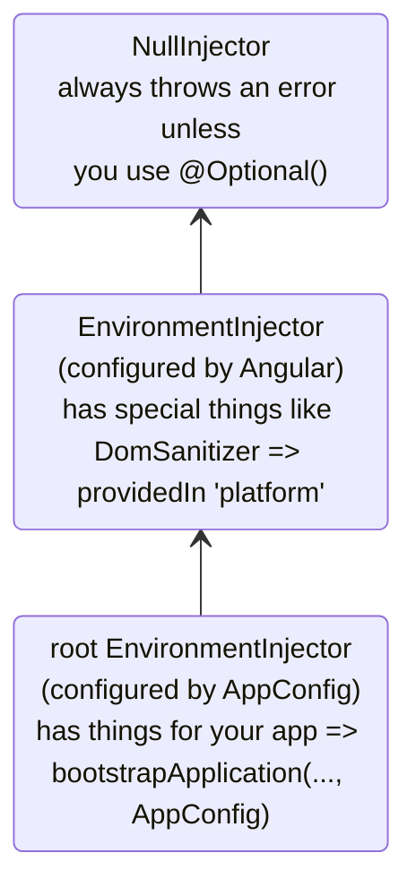
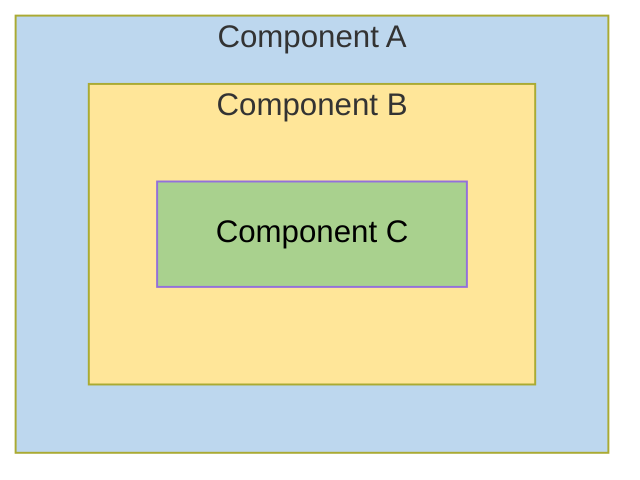
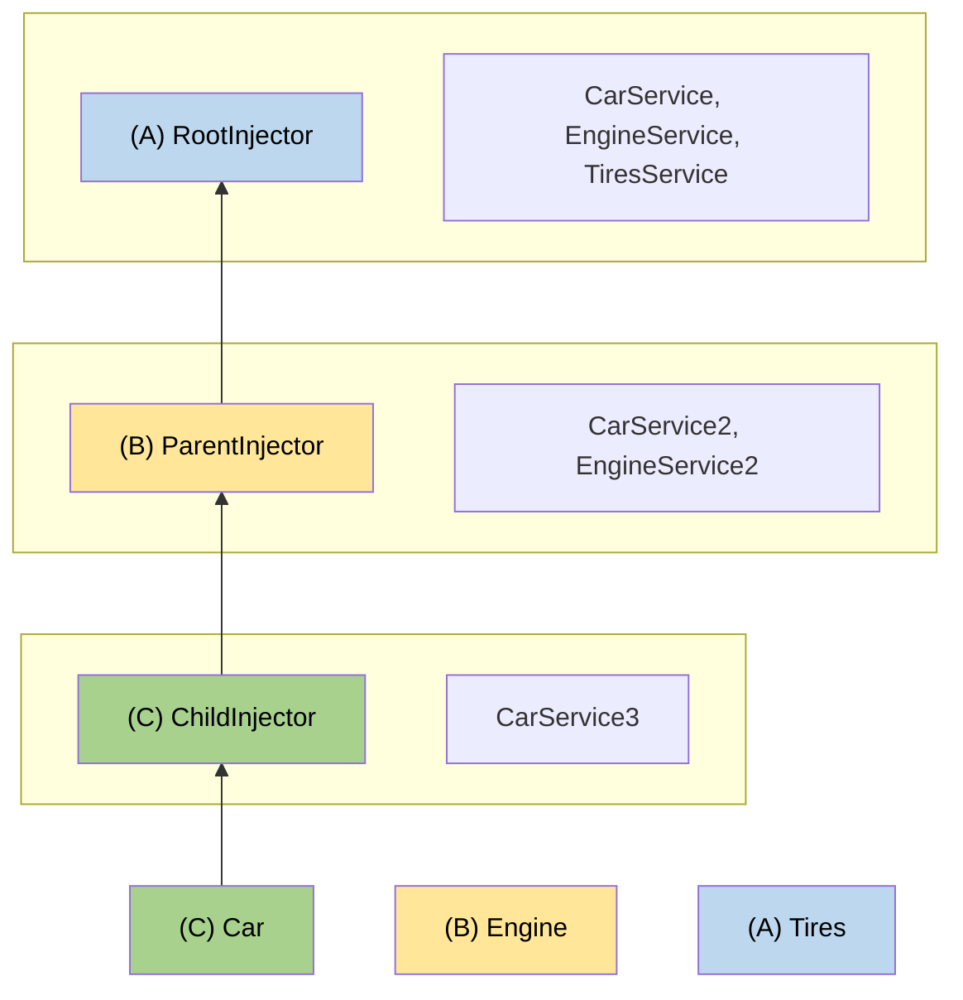

# 階層式注入器

本指南深入說明 Angular 的階層式依賴注入系統，包括解析規則、修飾符和進階模式。

NOTE: 關於注入器階層和提供者範圍的基本概念，請參閱[定義依賴提供者指南](guide/di/defining-dependency-providers#injector-hierarchy-in-angular)。

## 注入器階層的類型 {#types-of-injector-hierarchies}

Angular 有兩種注入器階層：

| 注入器階層                      | 詳細資訊                                                                                                                                                                  |
| :------------------------------ | :------------------------------------------------------------------------------------------------------------------------------------------------------------------------ |
| `EnvironmentInjector` 階層      | 使用 `@Service()` 或 `ApplicationConfig` 中的 `providers` 陣列，在此階層中設定 `EnvironmentInjector`。                                                                    |
| `ElementInjector` 階層          | 在每個 DOM 元素上隱含地建立。`ElementInjector` 預設是空的，除非你在 `@Directive()` 或 `@Component()` 的 `providers` 屬性中設定它。                                       |

<docs-callout title="以 NgModule 為基礎的應用程式">
對於以 `NgModule` 為基礎的應用程式，你可以使用 `@NgModule()` 或 `@Injectable()` 註記，透過 `ModuleInjector` 階層提供依賴。
</docs-callout>

### `EnvironmentInjector`

`EnvironmentInjector` 可以用以下兩種方式之一來設定：

- `@Service()`
- `ApplicationConfig` 的 `providers` 陣列

<docs-callout title="搖樹優化與 @Service()">

使用 `@Service()` 裝飾器比使用 `ApplicationConfig` 的 `providers` 陣列更可取。有了 `@Service`，最佳化工具可以執行搖樹優化，移除你的應用程式沒有使用的服務。如此能產生更小的 bundle。

搖樹優化對函式庫特別有用，因為使用該函式庫的應用程式可能不需要注入它。

</docs-callout>

`EnvironmentInjector` 由 `ApplicationConfig.providers` 設定。

使用 `@Service()` 提供服務的方式如下：

```ts {highlight:[4]}
import {Service} from '@angular/core';

@Service() // <--provides this service in the root EnvironmentInjector
export class ItemService {
  name = 'telephone';
}
```

`@Service()` 或 `@Injectable()` 裝飾器用來標識服務類別。

### ModuleInjector

對於以 `NgModule` 為基礎的應用程式，ModuleInjector 可以用以下兩種方式之一來設定：

- `@Service()` 裝飾器，
- 以 `@Injectable()` 的 `providedIn` 屬性指向 `root` 或 `platform`
- `@NgModule()` 的 `providers` 陣列

`ModuleInjector` 由 `@NgModule.providers` 和 `NgModule.imports` 屬性設定。`ModuleInjector` 是沿著 `NgModule.imports` 遞迴追蹤可觸及的所有 providers 陣列攤平後的結果。

延遲載入其他 `@NgModules` 時，會建立子 `ModuleInjector` 階層。

### 平台注入器

在 `root` 之上還有兩個注入器：一個額外的 `EnvironmentInjector` 和 `NullInjector()`。

想想 Angular 如何以 `main.ts` 中的以下程式碼啟動應用程式：

```ts
bootstrapApplication(App, appConfig);
```

`bootstrapApplication()` 方法會建立平台注入器的一個子注入器，它由 `ApplicationConfig` 實例設定。
這就是 `root` `EnvironmentInjector`。

`bootstrapApplication()` 方法也會建立（或重複使用）平台注入器，其中包含平台專屬的依賴。
這讓多個應用程式可以共用一個平台設定。
例如，無論你執行多少個應用程式，瀏覽器都只有一個網址列。
你可以使用 `platformBrowser()` 函式提供 `extraProviders`，在平台層級設定額外的平台專屬提供者。

階層中再往上的父注入器是 `NullInjector()`，它是這棵樹的頂端。
如果你沿著樹一路往上、最後在 `NullInjector()` 中尋找服務，你會收到一個錯誤，除非你使用了 `@Optional()`，因為最終一切都結束於 `NullInjector()`，它會傳回錯誤，或在 `@Optional()` 的情況下傳回 `null`。
關於 `@Optional()` 的更多資訊，請參閱本指南的 [`@Optional()` 一節](#optional)。

下圖呈現了 `root` `ModuleInjector` 與其父注入器之間的關係，如前幾段所述。



雖然 `root` 這個名稱是一個特殊的別名，其他 `EnvironmentInjector` 階層沒有別名。
你可以在動態載入元件建立時建立 `EnvironmentInjector` 階層，例如透過 Router，它會建立子 `EnvironmentInjector` 階層。

所有請求都會向上轉送到根注入器，無論你是用傳給 `bootstrapApplication()` 方法的 `ApplicationConfig` 實例來設定它，或是在各個服務本身以 `root` 註冊所有提供者。

<docs-callout title="@Injectable() 與 ApplicationConfig">

如果你在 `bootstrapApplication` 的 `ApplicationConfig` 中設定了一個全應用程式的提供者，它會覆寫在 `@Injectable()` 詮釋資料中為 `root` 設定的提供者。
你可以這樣做，來為一個與多個應用程式共用的服務設定非預設的提供者。

以下是一個範例：元件路由設定把非預設的[位置策略](guide/routing/common-router-tasks#locationstrategy-and-browser-url-styles)提供者列在 `ApplicationConfig` 的 `providers` 清單中。

```ts
providers: [{provide: LocationStrategy, useClass: HashLocationStrategy}];
```

對於以 `NgModule` 為基礎的應用程式，請在 `AppModule` 的 `providers` 中設定全應用程式的提供者。

</docs-callout>

### `ElementInjector`

Angular 會為每個 DOM 元素隱含地建立 `ElementInjector` 階層。

在 `@Component()` 裝飾器中使用它的 `providers` 或 `viewProviders` 屬性提供服務，就能設定一個 `ElementInjector`。
例如，以下 `TestComponent` 透過如下方式提供服務來設定 `ElementInjector`：

```ts {highlight:[3]}
@Component({
  /* … */
  providers: [{ provide: ItemService, useValue: { name: 'lamp' } }]
})
export class TestComponent
```

HELPFUL: 請參閱[解析規則](#resolution-rules)一節，了解 `EnvironmentInjector` 樹、`ModuleInjector` 和 `ElementInjector` 樹之間的關係。

當你在元件中提供服務時，該服務透過該元件實例的 `ElementInjector` 可供使用。
根據[解析規則](#resolution-rules)一節所述的可見性規則，它在子元件／指令中也可能可見。

當元件實例被銷毀時，該服務實例也會一併被銷毀。

#### `@Directive()` 與 `@Component()`

元件是指令的一種特殊類型，意思是就像 `@Directive()` 有 `providers` 屬性一樣，`@Component()` 也有。
這表示指令和元件都可以使用 `providers` 屬性來設定提供者。
當你使用 `providers` 屬性為元件或指令設定提供者時，該提供者屬於該元件或指令的 `ElementInjector`。
同一個元素上的元件和指令共用一個注入器。

## 解析規則 {#resolution-rules}

為元件／指令解析 token 時，Angular 會分兩個階段進行：

1. 對照它在 `ElementInjector` 階層中的父層。
2. 對照它在 `EnvironmentInjector` 階層中的父層。

當元件宣告一個依賴時，Angular 會試圖用它自己的 `ElementInjector` 來滿足該依賴。
如果元件的注入器缺少該提供者，它會把請求往上傳給父元件的 `ElementInjector`。

請求會不斷向上轉送，直到 Angular 找到能處理該請求的注入器，或用盡所有祖先 `ElementInjector` 階層為止。

如果 Angular 在任何 `ElementInjector` 階層中都找不到該提供者，它會回到請求發出的元素，並在 `EnvironmentInjector` 階層中尋找。
如果 Angular 仍然找不到該提供者，它就會擲出錯誤。

如果你在不同層級為同一個 DI token 註冊了提供者，Angular 遇到的第一個就是它用來解析該依賴的提供者。
例如，如果提供者在需要某個服務的元件中就地註冊，
Angular 就不會再尋找同一個服務的其他提供者。

HELPFUL: 對於以 `NgModule` 為基礎的應用程式，如果 Angular 在 `ElementInjector` 階層中找不到提供者，它會搜尋 `ModuleInjector` 階層。

## 解析修飾符

Angular 的解析行為可以用 `optional`、`self`、`skipSelf` 和 `host` 來修改。
從 `@angular/core` 匯入它們，並在你注入服務時，在 [`inject`](/api/core/inject) 設定中使用它們。

### 修飾符的類型

解析修飾符分為三類：

- 找不到你要找的東西時該怎麼做，也就是 `optional`
- 從哪裡開始找，也就是 `skipSelf`
- 在哪裡停止尋找，也就是 `host` 和 `self`

依預設，Angular 一律從目前的 `Injector` 開始，一路往上搜尋。
修飾符讓你可以改變開始（也就是 *self*）的位置和結束的位置。

此外，你可以組合所有修飾符，但以下組合除外：

- `host` 和 `self`
- `skipSelf` 和 `self`。

### `optional` {#optional}

`optional` 讓 Angular 把你注入的服務視為可選。
這樣一來，如果它在執行階段無法被解析，Angular 會把該服務解析為 `null`，而不是擲出錯誤。
在以下範例中，服務 `OptionalService` 沒有在服務、`ApplicationConfig`、`@NgModule()` 或元件類別中被提供，因此它在應用程式的任何地方都不可用。

```ts {header:"src/app/optional/optional.ts"}
export class Optional {
  public optional? = inject(OptionalService, {optional: true});
}
```

### `self`

使用 `self`，讓 Angular 只查看目前元件或指令的 `ElementInjector`。

`self` 的一個很好的使用情境是注入一個服務，但前提是它在目前的宿主元素上可用。
為了在這種情況下避免錯誤，把 `self` 與 `optional` 組合使用。

例如，在以下的 `SelfNoData` 中，注意作為屬性的被注入的 `LeafService`。

```ts {header: 'self-no-data.ts', highlight: [7]}
@Component({
  selector: 'app-self-no-data',
  templateUrl: './self-no-data.html',
  styleUrls: ['./self-no-data.css'],
})
export class SelfNoData {
  public leaf = inject(LeafService, {optional: true, self: true});
}
```

在這個範例中，存在一個父提供者，注入該服務會傳回該值；然而，以 `self` 和 `optional` 注入該服務會傳回 `null`，因為 `self` 告訴注入器在目前的宿主元素就停止搜尋。

另一個範例顯示帶有 `FlowerService` 提供者的元件類別。
在這種情況下，注入器不需要再往別處尋找，因為它在目前的 `ElementInjector` 中就找到了 `FlowerService`，並傳回鬱金香 🌷。

```ts {header:"src/app/self/self.ts"}
@Component({
  selector: 'app-self',
  templateUrl: './self.html',
  styleUrls: ['./self.css'],
  providers: [{provide: FlowerService, useValue: {emoji: '🌷'}}],
})
export class Self {
  public flower = inject(FlowerService, {self: true});
}
```

### `skipSelf`

`skipSelf` 是 `self` 的相反。
有了 `skipSelf`，Angular 會從父 `ElementInjector` 開始搜尋服務，而不是從目前的注入器開始。
因此，如果父 `ElementInjector` 為 `emoji` 使用的是蕨類 <code>🌿</code> 的值，但你在元件的 `providers` 陣列中有楓葉 <code>🍁</code>，Angular 會忽略楓葉 <code>🍁</code>，改用蕨類 <code>🌿</code>。

要在程式碼中看這一點，假設父元件使用的是以下的 `emoji` 值，如同這個服務：

```ts {header: 'leaf.service.ts'}
export class LeafService {
  emoji = '🌿';
}
```

想像在子元件中，你有一個不同的值，楓葉 🍁，但你想改用父元件的值。
這時你就會用 `skipSelf`：

```ts {header:"skipself.ts" highlight:[[6],[10]]}
@Component({
  selector: 'app-skipself',
  templateUrl: './skipself.html',
  styleUrls: ['./skipself.css'],
  // Angular would ignore this LeafService instance
  providers: [{provide: LeafService, useValue: {emoji: '🍁'}}],
})
export class Skipself {
  // Use skipSelf as inject option
  public leaf = inject(LeafService, {skipSelf: true});
}
```

在這種情況下，你為 `emoji` 取得的值會是蕨類 <code>🌿</code>，而不是楓葉 <code>🍁</code>。

#### `skipSelf` 選項搭配 `optional`

把 `skipSelf` 選項與 `optional` 一起使用，可以在值為 `null` 時避免錯誤。

在以下範例中，`Person` 服務在屬性初始化期間被注入。
`skipSelf` 告訴 Angular 跳過目前的注入器，而 `optional` 會在 `Person` 服務為 `null` 時避免錯誤。

```ts
class Person {
  parent = inject(Person, {optional: true, skipSelf: true});
}
```

### `host`

<!-- TODO: Remove ambiguity between host and self. -->

`host` 讓你在搜尋提供者時，把某個元件指定為注入器樹中的最後一站。

即使樹的更上方還有服務實例，Angular 也不會繼續尋找。
`host` 的使用方式如下：

```ts {header:"host.ts" highlight:[[6],[9]]}
@Component({
  selector: 'app-host',
  templateUrl: './host.html',
  styleUrls: ['./host.css'],
  // provide the service
  providers: [{provide: FlowerService, useValue: {emoji: '🌷'}}],
})
export class Host {
  // use host when injecting the service
  flower = inject(FlowerService, {host: true, optional: true});
}
```

由於 `Host` 有 `host` 選項，無論 `Host` 的父層的 `flower.emoji` 值是什麼，`Host` 都會使用鬱金香 <code>🌷</code>。

### 建構子注入的修飾符

如同先前所呈現的，建構子注入的行為可以用 `@Optional()`、`@Self()`、`@SkipSelf()` 和 `@Host()` 來修改。

從 `@angular/core` 匯入它們，並在你注入服務時，在元件類別的建構子中使用它們。

```ts {header:"self-no-data.ts" highlight:[2]}
export class SelfNoData {
  constructor(@Self() @Optional() public leaf?: LeafService) {}
}
```

## 範本的邏輯結構

當你在元件類別中提供服務時，服務在 `ElementInjector` 樹中的可見性，取決於你提供這些服務的位置和方式。

了解 Angular 範本底層的邏輯結構，能為你設定服務、進而控制它們的可見性打下基礎。

元件在你的範本中被使用，如以下範例：

```html
<app-root> <app-child />; </app-root>
```

HELPFUL: 通常，你會把元件和它們的範本宣告在不同的檔案中。
為了理解注入系統如何運作，從合併後的邏輯樹的角度來看它們會很有幫助。
*邏輯*一詞是為了把它與算繪樹區分開來，算繪樹就是你的應用程式的 DOM 樹。
為了標記元件範本所在的位置，本指南使用 `<#VIEW>` 虛擬元素，它實際上並不存在於算繪樹中，只是為了心智模型而存在。

以下是一個範例，示範 `<app-root>` 和 `<app-child>` 的檢視樹如何合併成單一的邏輯樹：

```html
<app-root>
  <#VIEW>
    <app-child>
     <#VIEW>
       …content goes here…
     </#VIEW>
    </app-child>
  </#VIEW>
</app-root>
```

了解 `<#VIEW>` 分界的概念，在你於元件類別中設定服務時尤其重要。

## 範例：在 `@Component()` 中提供服務

你使用 `@Component()`（或 `@Directive()`）裝飾器提供服務的方式，決定了它們的可見性。
以下各節示範 `providers` 和 `viewProviders`，以及用 `skipSelf` 和 `host` 修改服務可見性的方法。

元件類別可以用兩種方式提供服務：

| 陣列                         | 詳細資訊                                       |
| :--------------------------- | :--------------------------------------------- |
| 使用 `providers` 陣列        | `@Component({ providers: [SomeService] })`     |
| 使用 `viewProviders` 陣列    | `@Component({ viewProviders: [SomeService] })` |

在以下範例中，你會看到一個 Angular 應用程式的邏輯樹。
為了說明注入器在範本脈絡中如何運作，邏輯樹將呈現應用程式的 HTML 結構。
例如，邏輯樹會顯示 `<child-component>` 是 `<parent-component>` 的直接子元素。

在邏輯樹中，你會看到特殊屬性：`@Provide`、`@Inject` 和 `@ApplicationConfig`。
這些不是真正的屬性，而是用來示範底層發生了什麼。

| Angular 服務屬性          | 詳細資訊                                                                                 |
| :------------------------ | :--------------------------------------------------------------------------------------- |
| `@Inject(Token)=>Value`   | 如果 `Token` 在邏輯樹的這個位置被注入，它的值會是 `Value`。                              |
| `@Provide(Token=Value)`   | 表示 `Token` 在邏輯樹的這個位置以 `Value` 被提供。                                       |
| `@ApplicationConfig`      | 示範在此位置應該使用備用的 `EnvironmentInjector`。                                       |

### 範例應用程式結構

範例應用程式有一個在 `root` 提供的 `FlowerService`，其 `emoji` 值為紅色扶桑花 <code>🌺</code>。

```ts {header:"flower.service.ts"}
@Service()
export class FlowerService {
  emoji = '🌺';
}
```

設想一個只有 `App` 和 `Child` 的應用程式。
最基本的算繪檢視會像以下這樣巢狀的 HTML 元素：

```html
<app-root>
  <!-- App selector -->
  <app-child> <!-- Child selector --> </app-child>
</app-root>
```

然而，在幕後，Angular 在解析注入請求時使用如下的邏輯檢視表示法：

```html
<app-root> <!-- App selector -->
  <#VIEW>
    <app-child> <!-- Child selector -->
      <#VIEW>
      </#VIEW>
    </app-child>
  </#VIEW>
</app-root>
```

這裡的 `<#VIEW>` 代表一個範本的實例。
注意每個元件都有自己的 `<#VIEW>`。

了解這個結構能幫助你決定如何提供和注入服務，並讓你完全掌控服務的可見性。

現在，設想 `<app-root>` 注入了 `FlowerService`：

```typescript
export class App {
  flower = inject(FlowerService);
}
```

在 `<app-root>` 範本中加入一個繫結，來視覺化結果：

```html
<p>Emoji from FlowerService: {{flower.emoji}}</p>
```

檢視中的輸出會是：

```text {hideCopy}
Emoji from FlowerService: 🌺
```

在邏輯樹中，這會表示如下：

```html
<app-root @ApplicationConfig
        @Inject(FlowerService) flower=>"🌺">
  <#VIEW>
    <p>Emoji from FlowerService: {{flower.emoji}} (🌺)</p>
    <app-child>
      <#VIEW>
      </#VIEW>
    </app-child>
  </#VIEW>
</app-root>
```

當 `<app-root>` 請求 `FlowerService` 時，解析 `FlowerService` token 是注入器的工作。
token 的解析分兩個階段進行：

1. 注入器決定邏輯樹中的起始位置和搜尋的結束位置。
   注入器從起始位置開始，在邏輯樹的每個檢視層級尋找 token。
   如果找到 token，就把它傳回。

1. 如果找不到 token，注入器會尋找最近的父 `EnvironmentInjector`，把請求委派給它。

在這個範例中，限制條件如下：

1. 從屬於 `<app-root>` 的 `<#VIEW>` 開始，以 `<app-root>` 結束。
   - 一般來說，搜尋的起點是注入的位置。
     然而，在這個情況下，`<app-root>` 是一個元件。`@Component` 的特殊之處在於它們也包含自己的 `viewProviders`，這就是搜尋從屬於 `<app-root>` 的 `<#VIEW>` 開始的原因。
     對於在同一個位置比對到的指令，情況就不是這樣。
   - 結束位置恰好與元件本身相同，因為它是這個應用程式中最上層的元件。

1. 由 `ApplicationConfig` 提供的 `EnvironmentInjector`，在 `ElementInjector` 階層中找不到注入 token 時，充當備用注入器。

### 使用 `providers` 陣列

現在，在 `Child` 類別中，為 `FlowerService` 加入一個提供者，以在接下來的章節中示範更複雜的解析規則：

```ts
@Component({
  selector: 'app-child',
  templateUrl: './child.html',
  styleUrls: ['./child.css'],
  // use the providers array to provide a service
  providers: [{provide: FlowerService, useValue: {emoji: '🌻'}}],
})
export class Child {
  // inject the service
  flower = inject(FlowerService);
}
```

既然 `FlowerService` 已在 `@Component()` 裝飾器中提供，當 `<app-child>` 請求該服務時，注入器只需要找到 `<app-child>` 中的 `ElementInjector` 為止。
它不需要再沿著注入器樹繼續搜尋。

下一步是在 `Child` 範本中加入一個繫結。

```html
<p>Emoji from FlowerService: {{flower.emoji}}</p>
```

若要算繪新的值，把 `<app-child>` 加入 `App` 範本的底部，讓檢視也顯示向日葵：

```text {hideCopy}
Child Component
Emoji from FlowerService: 🌻
```

在邏輯樹中，這表示如下：

```html
<app-root @ApplicationConfig
          @Inject(FlowerService) flower=>"🌺">
  <#VIEW>

  <p>Emoji from FlowerService: {{flower.emoji}} (🌺)</p>
  <app-child @Provide(FlowerService="🌻" )
             @Inject(FlowerService)=>"🌻"> <!-- search ends here -->
    <#VIEW> <!-- search starts here -->
    <h2>Child Component</h2>
    <p>Emoji from FlowerService: {{flower.emoji}} (🌻)</p>
  </
  #VIEW>
  </app-child>
</#VIEW>
</app-root>
```

當 `<app-child>` 請求 `FlowerService` 時，注入器從屬於 `<app-child>` 的 `<#VIEW>` 開始搜尋（`<#VIEW>` 被包括在內，是因為它從 `@Component()` 注入），並以 `<app-child>` 結束。
在這種情況下，`FlowerService` 以 `<app-child>` 的 `providers` 陣列中向日葵 <code>🌻</code> 的值被解析。
注入器不需要在注入器樹中再往別處尋找。
它一找到 `FlowerService` 就停下來，永遠不會看到紅色扶桑花 <code>🌺</code>。

### 使用 `viewProviders` 陣列 {#using-the-viewproviders-array}

使用 `viewProviders` 陣列，是在 `@Component()` 裝飾器中提供服務的另一種方式。
使用 `viewProviders` 讓服務在 `<#VIEW>` 中可見。

HELPFUL: 步驟與使用 `providers` 陣列相同，唯一的例外是改用 `viewProviders` 陣列。

如需逐步說明，請繼續閱讀本節。
如果你可以自行設定，請跳到[修改服務可用性](#visibility-of-provided-tokens)。

為了示範，我們建立一個 `AnimalService` 來示範 `viewProviders`。
首先，建立一個 `AnimalService`，其 `emoji` 屬性為鯨魚 <code>🐳</code>：

```typescript
import {Service} from '@angular/core';

@Service()
export class AnimalService {
  emoji = '🐳';
}
```

遵循與 `FlowerService` 相同的模式，在 `App` 類別中注入 `AnimalService`：

```ts
export class App {
  public flower = inject(FlowerService);
  public animal = inject(AnimalService);
}
```

HELPFUL: 你可以保留所有 `FlowerService` 相關的程式碼，因為這能讓你與 `AnimalService` 做對照比較。

也為 `<app-child>` 類別加入 `viewProviders` 陣列並注入 `AnimalService`，但給 `emoji` 一個不同的值。
在這裡，它的值是狗 🐶。

```typescript
@Component({
  selector: 'app-child',
  templateUrl: './child.html',
  styleUrls: ['./child.css'],
  // provide services
  providers: [{provide: FlowerService, useValue: {emoji: '🌻'}}],
  viewProviders: [{provide: AnimalService, useValue: {emoji: '🐶'}}],
})
export class Child {
  // inject services
  flower = inject(FlowerService);
  animal = inject(AnimalService);
}
```

在 `Child` 和 `App` 範本中加入繫結。
在 `Child` 範本中，加入以下繫結：

```html
<p>Emoji from AnimalService: {{animal.emoji}}</p>
```

此外，在 `App` 範本中也加入相同的繫結：

```html
<p>Emoji from AnimalService: {{animal.emoji}}</p>
```

現在你應該能在瀏覽器中看到這兩個值：

```text {hideCopy}
App
Emoji from AnimalService: 🐳

Child Component
Emoji from AnimalService: 🐶
```

這個 `viewProviders` 範例的邏輯樹如下：

```html
<app-root @ApplicationConfig
          @Inject(AnimalService) animal=>"🐳">
  <#VIEW>
  <app-child>
    <#VIEW @Provide(AnimalService="🐶")
    @Inject(AnimalService=>"🐶")>

    <!-- ^^using viewProviders means AnimalService is available in <#VIEW>-->
    <p>Emoji from AnimalService: {{animal.emoji}} (🐶)</p>
  </
  #VIEW>
  </app-child>
</#VIEW>
</app-root>
```

就如同 `FlowerService` 範例一樣，`AnimalService` 在 `<app-child>` 的 `@Component()` 裝飾器中被提供。
這表示由於注入器先在元件的 `ElementInjector` 中尋找，它找到了狗 <code>🐶</code> 的 `AnimalService` 值。
它不需要繼續搜尋 `ElementInjector` 樹，也不需要搜尋 `ModuleInjector`。

### `providers` 與 `viewProviders`

`viewProviders` 欄位在概念上與 `providers` 相似，但有一個值得注意的差異。
`viewProviders` 中的提供者只在元件自己的檢視內可見，透過 `<ng-content>` 投影進元件的內容看不到它們。

若要看出使用 `providers` 與 `viewProviders` 的差異，在範例中再加入一個元件，稱它為 `Inspector`。
`Inspector` 將是 `Child` 的子元件。
在 `inspector.ts` 中，在屬性初始化期間注入 `FlowerService` 和 `AnimalService`：

```typescript
export class Inspector {
  flower = inject(FlowerService);
  animal = inject(AnimalService);
}
```

你不需要 `providers` 或 `viewProviders` 陣列。
接著，在 `inspector.html` 中，加入與前面元件相同的標記：

```html
<p>Emoji from FlowerService: {{flower.emoji}}</p>
<p>Emoji from AnimalService: {{animal.emoji}}</p>
```

記得把 `Inspector` 加入 `Child` 的 `imports` 陣列。

```ts
@Component({
  ...
  imports: [Inspector]
})
```

接著，在 `child.html` 中加入以下內容：

```html
...

<div class="container">
  <h3>Content projection</h3>
  <ng-content />
</div>
<h3>Inside the view</h3>

<app-inspector />
```

`<ng-content>` 讓你可以投影內容，而 `Child` 範本內的 `<app-inspector>` 使 `Inspector` 成為 `Child` 的子元件。

接著，在 `app.html` 中加入以下內容，以運用內容投影。

```html
<app-child>
  <app-inspector />
</app-child>
```

瀏覽器現在算繪出以下內容（為求簡潔，省略先前的範例）：

```text {hideCopy}
...
Content projection

Emoji from FlowerService: 🌻
Emoji from AnimalService: 🐳

Emoji from FlowerService: 🌻
Emoji from AnimalService: 🐶
```

這四個繫結示範了 `providers` 與 `viewProviders` 的差異。
記住，狗 emoji <code>🐶</code> 是在 `Child` 的 `<#VIEW>` 內宣告的，對投影進來的內容不可見。
相反地，投影進來的內容看到的是鯨魚 <code>🐳</code>。

你可能會疑惑，為什麼被投影的 `<app-inspector>` 仍然看得到 <code>🐳</code>，也就是根層級提供的 `AnimalService`。
原因是 Angular DI 追蹤的是**元件在哪裡被宣告**，而不是它最終在哪裡被算繪。
`<app-inspector>` 位於 `App` 的範本中，在 `App` 的 `<#VIEW>` 內，因此它的查找永遠不會經過 `Child` 的 `<#VIEW>`。
把它投影進 `Child`，切斷了它對 `Child` 的 `viewProviders`（<code>🐶</code>）的存取，但根層級的 `AnimalService`（<code>🐳</code>）仍然可以沿著樹往上觸及。

然而，在下一個輸出區段中，`Inspector` 是 `Child` 的實際子元件，`Inspector` 在 `<#VIEW>` 內，因此當它索取 `AnimalService` 時，它看到的是狗 <code>🐶</code>。

邏輯樹中的 `AnimalService` 會像這樣：

```html
<app-root @ApplicationConfig
          @Inject(AnimalService) animal=>"🐳">
  <#VIEW>
  <app-child>
    <#VIEW @Provide(AnimalService="🐶")
    @Inject(AnimalService=>"🐶")>

    <!-- ^^using viewProviders means AnimalService is available in <#VIEW>-->
    <p>Emoji from AnimalService: {{animal.emoji}} (🐶)</p>

    <div class="container">
      <h3>Content projection</h3>
      <app-inspector @Inject(AnimalService) animal=>"🐳">
        <p>Emoji from AnimalService: {{animal.emoji}} (🐳)</p>
      </app-inspector>
    </div>

    <app-inspector>
      <#VIEW @Inject(AnimalService) animal=>"🐶">
      <p>Emoji from AnimalService: {{animal.emoji}} (🐶)</p>
    </
    #VIEW>
    </app-inspector>
  </
  #VIEW>
  </app-child>

</#VIEW>
</app-root>
```

被投影的 `<app-inspector>` 取得 <code>🐳</code>，因為 <code>🐶</code> 屬於 `Child` 的檢視，投影進來的內容觸及不到它。
<code>🐳</code> 可以被存取，是因為 `<app-inspector>` 是在 `App` 的範本中宣告的，因此它仍然可以沿著樹往上走到根層級的 `AnimalService`。

直接位於 `Child` 範本內（不是被投影）的 `<app-inspector>` 取得 <code>🐶</code>，因為它在 `<#VIEW>` 內，沒有邊界需要跨越。

### 讓投影進來的內容存取檢視注入器

以 `<ng-content>` 投影進來的內容看不到元件的 `viewProviders`，因為 Angular 是對照內容被宣告位置的注入器來解析注入，而不是它算繪的位置。

當你特別想讓投影進來的內容觸及檢視層級的服務（或投影元件實例本身）時，把內容作為範本接受，而不是用 `<ng-content>`，並以明確的注入器來算繪它。

更新 `Child`，在 `viewProviders` 中提供 `AnimalService`，查詢被投影的範本，並透過 [`NgTemplateOutlet`](/api/common/NgTemplateOutlet) 算繪它，把 `ngTemplateOutletInjector` 設為一個看得到該服務的注入器：

```ts
@Component({
  selector: 'app-child',
  viewProviders: [AnimalService],
  imports: [NgTemplateOutlet],
  template: `
    <ng-container [ngTemplateOutlet]="content()" [ngTemplateOutletInjector]="injector" />
  `,
})
export class Child {
  readonly content = contentChild.required(TemplateRef);
  readonly injector = inject(Injector);
}
```

使用者把被投影的標記包在 `<ng-template>` 中：

```html
<app-child>
  <ng-template>
    <app-inspector />
  </ng-template>
</app-child>
```

`Child` 現在用自己的注入器在出口處建立 `<app-inspector>`，因此即使標記寫在 `App` 的範本中，`AnimalService` 也會解析為狗 <code>🐶</code>。代價是與 `<ng-content>` 相比，兩邊都要多寫一點標記。

### 被提供 token 的可見性 {#visibility-of-provided-tokens}

可見性裝飾器影響在邏輯樹中搜尋注入 token 的起點和終點。
若要做到這一點，把可見性設定放在注入點，也就是叫用 `inject()` 時，而不是宣告點。

若要改變注入器開始尋找 `FlowerService` 的位置，在 `<app-child>` 注入 `FlowerService` 的 `inject()` 叫用中加入 `skipSelf`。
這個叫用是 `<app-child>` 中的一個屬性初始化器，如 `child.ts` 所示：

```typescript
flower = inject(FlowerService, {skipSelf: true});
```

有了 `skipSelf`，`<app-child>` 注入器不會向自己尋找 `FlowerService`。
相反地，注入器從 `<app-root>` 的 `ElementInjector` 開始尋找 `FlowerService`，但在那裡什麼也找不到。
接著，它回到 `<app-child>` 的 `ModuleInjector`，找到紅色扶桑花 <code>🌺</code> 的值，它之所以可用，是因為 `<app-child>` 和 `<app-root>` 共用同一個 `ModuleInjector`。
UI 算繪出以下內容：

```text {hideCopy}
Emoji from FlowerService: 🌺
```

在邏輯樹中，同樣的概念可能像這樣：

```html
<app-root @ApplicationConfig
          @Inject(FlowerService) flower=>"🌺">
  <#VIEW>
  <app-child @Provide(FlowerService="🌻" )>
    <#VIEW @Inject(FlowerService, SkipSelf)=>"🌺">

    <!-- With SkipSelf, the injector looks to the next injector up the tree (app-root) -->

  </
  #VIEW>
  </app-child>
</#VIEW>
</app-root>
```

儘管 `<app-child>` 提供了向日葵 <code>🌻</code>，應用程式卻算繪出紅色扶桑花 <code>🌺</code>，因為 `skipSelf` 使目前的注入器（`app-child`）跳過自己、看向它的父層。

如果你現在再加上 `host`（除了 `skipSelf` 之外），結果會是 `null`。
這是因為 `host` 把搜尋的上限限制在 `app-child` 的 `<#VIEW>`。
邏輯樹中的概念如下：

```html
<app-root @ApplicationConfig
          @Inject(FlowerService) flower=>"🌺">
  <#VIEW> <!-- end search here with null-->
  <app-child @Provide(FlowerService="🌻" )> <!-- start search here -->
    <#VIEW inject(FlowerService, {skipSelf: true, host: true, optional:true})=>null>
  </
  #VIEW>
  </app-parent>
</#VIEW>
</app-root>
```

在這裡，服務和它們的值都相同，但 `host` 阻止注入器在 `<#VIEW>` 之外繼續尋找 `FlowerService`，因此它找不到該服務並傳回 `null`。

### `skipSelf` 與 `viewProviders`

記住，`<app-child>` 在 `viewProviders` 陣列中提供了 `AnimalService`，其值為狗 <code>🐶</code>。
因為注入器只需要查看 `<app-child>` 的 `ElementInjector` 就能找到 `AnimalService`，它永遠不會看到鯨魚 <code>🐳</code>。

如同 `FlowerService` 範例，如果你把 `skipSelf` 加入 `AnimalService` 的 `inject()`，注入器就不會在目前 `<app-child>` 的 `ElementInjector` 中尋找 `AnimalService`。
相反地，注入器會從 `<app-root>` 的 `ElementInjector` 開始。

```typescript
@Component({
  selector: 'app-child',
  …
  viewProviders: [
    { provide: AnimalService, useValue: { emoji: '🐶' } },
  ],
})
```

在 `<app-child>` 中有 `skipSelf` 時，邏輯樹看起來像這樣：

```html
<app-root @ApplicationConfig
          @Inject(AnimalService=>"🐳")>
  <#VIEW><!-- search begins here -->
  <app-child>
    <#VIEW @Provide(AnimalService="🐶")
    @Inject(AnimalService, SkipSelf=>"🐳")>

    <!--Add skipSelf -->

  </
  #VIEW>
  </app-child>
</#VIEW>
</app-root>
```

在 `<app-child>` 中有 `skipSelf` 時，注入器從 `<app-root>` 的 `ElementInjector` 開始搜尋 `AnimalService`，並找到鯨魚 🐳。

### `host` 與 `viewProviders`

如果你只對 `AnimalService` 的注入使用 `host`，結果會是狗 <code>🐶</code>，因為注入器在 `<app-child>` 的 `<#VIEW>` 本身就找到了 `AnimalService`。
`Child` 設定了 `viewProviders`，使狗 emoji 被提供為 `AnimalService` 的值。
你也可以在 `inject()` 中看到 `host`：

```typescript
@Component({
  selector: 'app-child',
  …
  viewProviders: [
    { provide: AnimalService, useValue: { emoji: '🐶' } },
  ]
})
export class Child {
  animal = inject(AnimalService, { host: true })
}
```

`host: true` 使注入器一直找到 `<#VIEW>` 的邊界為止。

```html
<app-root @ApplicationConfig
          @Inject(AnimalService=>"🐳")>
  <#VIEW>
  <app-child>
    <#VIEW @Provide(AnimalService="🐶")
    inject(AnimalService, {host: true}=>"🐶")> <!-- host stops search here -->
  </
  #VIEW>
  </app-child>
</#VIEW>
</app-root>
```

在 `app.ts` 的 `@Component()` 詮釋資料中，加入一個帶有第三種動物，刺蝟 <code>🦔</code> 的 `viewProviders` 陣列：

```typescript
@Component({
  selector: 'app-root',
  templateUrl: './app.html',
  styleUrls: [ './app.css' ],
  viewProviders: [
    { provide: AnimalService, useValue: { emoji: '🦔' } },
  ],
})
```

接著，在 `child.ts` 中為 `AnimalService` 注入的 `inject()` 加入 `skipSelf` 以及 `host`。
以下是在 `animal` 屬性初始化中的 `host` 和 `skipSelf`：

```typescript
export class Child {
  animal = inject(AnimalService, {host: true, skipSelf: true});
}
```

<!-- TODO: This requires a rework. It seems not well explained what `viewProviders`/`injectors` is here
  and how `host` works.
 -->

當 `host` 和 `skipSelf` 被套用到位於 `providers` 陣列中的 `FlowerService` 時，結果是 `null`，因為 `skipSelf` 從 `<app-child>` 注入器開始搜尋，但 `host` 在 `<#VIEW>` 就停止搜尋，而那裡沒有 `FlowerService`。
在邏輯樹中，你可以看到 `FlowerService` 在 `<app-child>` 中可見，而不是在它的 `<#VIEW>` 中。

然而，在 `App` 的 `viewProviders` 陣列中提供的 `AnimalService` 是可見的。

邏輯樹的表示法說明了為什麼會這樣：

```html
<app-root @ApplicationConfig
          @Inject(AnimalService=>"🐳")>
  <#VIEW @Provide(AnimalService="🦔")
  @Inject(AnimalService, @Optional)=>"🦔">

  <!-- ^^skipSelf starts here,  host stops here^^ -->
  <app-child>
    <#VIEW @Provide(AnimalService="🐶")
    inject(AnimalService, {skipSelf:true, host: true, optional: true})=>"🦔">
    <!-- Add skipSelf ^^-->
  </
  #VIEW>
  </app-child>
</#VIEW>
</app-root>
```

`skipSelf` 使注入器從 `<app-root>` 開始搜尋 `AnimalService`，而不是請求發出的 `<app-child>`，而 `host` 在 `<app-root>` 的 `<#VIEW>` 停止搜尋。
由於 `AnimalService` 是透過 `viewProviders` 陣列提供的，注入器在 `<#VIEW>` 中找到了刺蝟 <code>🦔</code>。

## 範例：`ElementInjector` 使用情境

能在不同層級設定一個或多個提供者，開啟了許多有用的可能性。

### 情境：服務隔離

架構上的理由可能讓你想把對某個服務的存取，限制在它所屬的應用程式領域內。
例如，設想我們建立一個 `VillainsList` 來顯示反派清單。
它從 `VillainsService` 取得那些反派。

如果你在根層級的 `AppModule` 中提供 `VillainsService`，它會讓 `VillainsService` 在應用程式的任何地方都可見。
如果你日後修改 `VillainsService`，你可能會破壞其他不小心開始依賴這個服務的元件。

相反地，你應該像這樣在 `VillainsList` 的 `providers` 詮釋資料中提供 `VillainsService`：

```typescript
@Component({
  selector: 'app-villains-list',
  templateUrl: './villains-list.html',
  providers: [VillainsService],
})
export class VillainsList {}
```

透過只在 `VillainsList` 的詮釋資料中提供 `VillainsService`、而不在其他任何地方提供，該服務就只在 `VillainsList` 及其子元件樹中可用。

`VillainsService` 相對於 `VillainsList` 而言是單例，因為它就是在那裡宣告的。
只要 `VillainsList` 沒有被銷毀，它就會是同一個 `VillainsService` 實例；但如果有多個 `VillainsList` 實例，那麼每個 `VillainsList` 實例都會有自己的 `VillainsService` 實例。

### 情境：多個編輯工作階段

許多應用程式允許使用者同時處理多個開啟中的工作。
例如，在報稅應用程式中，報稅人員可以同時處理多份報稅表，在一天中在它們之間切換。

若要示範這個情境，想像一個顯示超級英雄清單的 `HeroList`。

若要開啟某位英雄的報稅表，報稅人員點擊英雄的名字，就會開啟一個用於編輯該報稅表的元件。
每份被選取的英雄報稅表都在自己的元件中開啟，多份報稅表可以同時開啟。

每個報稅表元件都有以下特點：

- 是它自己的報稅表編輯工作階段
- 可以變更報稅表，而不會影響另一個元件中的報稅表
- 能夠儲存對其報稅表的變更，或取消它們

假設 `HeroTaxReturnEditor` 有管理與還原變更的邏輯。
對於英雄報稅表來說，那會是一件直截了當的工作。
在真實世界中，面對豐富的報稅表資料模型，變更管理工作會很棘手。
你可以把這項管理委派給一個輔助服務，如本範例所示。

`HeroTaxReturnService` 快取單一的 `HeroTaxReturn`，追蹤對該報稅表的變更，並能儲存或還原它。
它也會委派給整個應用程式範圍的單例 `HeroService`，它透過注入取得該服務。

```typescript
import {inject, Service} from '@angular/core';
import {HeroTaxReturn} from './hero';
import {HeroesService} from './heroes.service';

@Service({autoProvided: false})
export class HeroTaxReturnService {
  private currentTaxReturn!: HeroTaxReturn;
  private originalTaxReturn!: HeroTaxReturn;

  private heroService = inject(HeroesService);

  set taxReturn(htr: HeroTaxReturn) {
    this.originalTaxReturn = htr;
    this.currentTaxReturn = htr.clone();
  }

  get taxReturn(): HeroTaxReturn {
    return this.currentTaxReturn;
  }

  restoreTaxReturn() {
    this.taxReturn = this.originalTaxReturn;
  }

  saveTaxReturn() {
    this.taxReturn = this.currentTaxReturn;
    this.heroService.saveTaxReturn(this.currentTaxReturn).subscribe();
  }
}
```

以下是使用 `HeroTaxReturnService` 的 `HeroTaxReturnEditor`。

```typescript
import {Component, effect, inject, input, output} from '@angular/core';
import {HeroTaxReturn} from './hero';
import {HeroTaxReturnService} from './hero-tax-return.service';

@Component({
  selector: 'app-hero-tax-return',
  templateUrl: './hero-tax-return.html',
  styleUrls: ['./hero-tax-return.css'],
  providers: [HeroTaxReturnService],
})
export class HeroTaxReturnEditor {
  message = '';

  close = output<void>();

  taxReturn = input.required<HeroTaxReturn>();

  private heroTaxReturnService = inject(HeroTaxReturnService);

  constructor() {
    effect(() => {
      this.heroTaxReturnService.taxReturn = this.taxReturn();
    });
  }

  onCanceled() {
    this.flashMessage('Canceled');
    this.heroTaxReturnService.restoreTaxReturn();
  }

  onClose() {
    this.close.emit();
  }

  onSaved() {
    this.flashMessage('Saved');
    this.heroTaxReturnService.saveTaxReturn();
  }

  flashMessage(msg: string) {
    this.message = msg;
    setTimeout(() => (this.message = ''), 500);
  }
}
```

*要編輯的報稅表*透過 `taxReturn` 訊號輸入抵達。
每當輸入變更時，一個 `effect` 就會以傳入的報稅表初始化元件自己的 `HeroTaxReturnService` 實例。
服務的 getter 永遠傳回服務所稱的英雄目前狀態。
元件也會要求服務儲存與還原這份報稅表。

如果服務是整個應用程式範圍的單例，這就行不通了。
每個元件都會共用同一個服務實例，而每個元件都會覆寫屬於另一位英雄的報稅表。

若要防止這一點，設定 `HeroTaxReturnEditor` 的元件層級注入器來提供該服務，使用元件詮釋資料中的 `providers` 屬性。

```typescript
providers: [HeroTaxReturnService];
```

`HeroTaxReturnEditor` 有它自己的 `HeroTaxReturnService` 提供者。
回想一下，每個元件*實例*都有自己的注入器。
在元件層級提供服務，確保該元件的*每個*實例都能取得服務的一個私密實例。這能確保沒有任何報稅表會被覆寫。

HELPFUL: 本情境其餘的程式碼仰賴其他 Angular 功能與技巧，你可以在文件其他地方學到它們。

### 情境：專門化的提供者

在另一個層級再次提供服務的另一個理由是，在元件樹更深處替換成該服務*更專門化*的實作。

例如，設想一個 `Car` 元件，它包含輪胎服務資訊，並依賴其他服務來提供關於汽車的更多細節。

根注入器，標記為 (A)，為 `CarService` 和 `EngineService` 的細節使用*通用*提供者。

1. `Car` 元件 (A)。元件 (A) 顯示關於汽車的輪胎服務資料，並指定通用服務來提供關於汽車的更多資訊。

2. 子元件 (B)。元件 (B) 為 `CarService` 和 `EngineService` 定義它自己的*專門化*提供者，它們具有適合元件 (B) 中發生之事的特殊能力。

3. 子元件 (C)，是元件 (B) 的子元件。元件 (C) 為 `CarService` 定義它自己的、甚至*更專門化*的提供者。



在幕後，每個元件都設定了自己的注入器，其中為該元件本身定義了零個、一個或多個提供者。

當你在最深的元件 (C) 解析 `Car` 的一個實例時，它的注入器產生：

- 一個由注入器 (C) 解析的 `Car` 實例
- 一個由注入器 (B) 解析的 `Engine`
- 它的 `Tires` 由根注入器 (A) 解析。



## 依賴注入的更多資訊

<docs-pill-row>
  <docs-pill href="/guide/di/defining-dependency-providers" title="DI 提供者"/>
</docs-pill-row>
