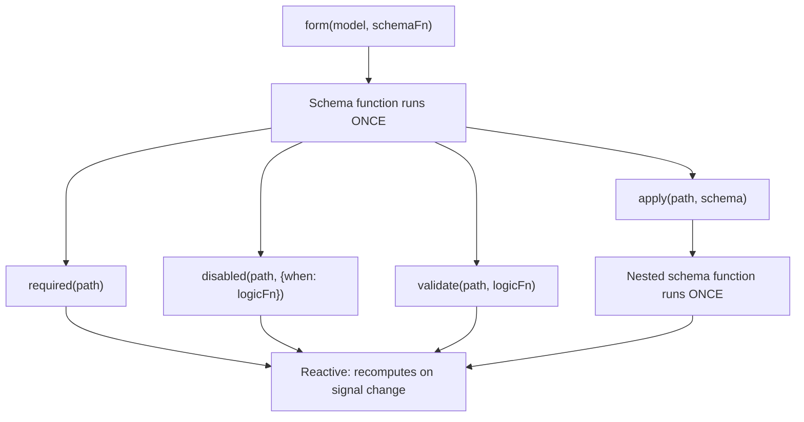

# 結構定義與結構定義的可組合性

訊號表單採用雙層架構，將表單的_結構方式_與_執行階段的行為_分開。

當你把結構定義函式傳給 `form()` 時，該函式會在建立表單期間_執行一次_。它的工作是宣告哪些欄位需要驗證、哪些欄位要停用、以及哪些欄位相依於其他欄位，以此建立表單的邏輯樹。這就是表單的**結構層**。

在結構定義函式中，你會呼叫 `disabled()` 與 `validate()` 等規則函式。這些規則函式接受反應式邏輯，每當它們參照的訊號變更時就會重新計算。`disabled()` 與 `required()` 等條件規則接受選擇性的設定，其中包含一個 `when` 函式，用來啟用該規則。這些共同構成表單在執行階段的**行為層**。

```ts
contactForm = form(this.contactModel, (schemaPath) => {
  // Schema function: runs ONCE during form creation
  required(schemaPath.name);
  disabled(schemaPath.couponCode, {when: ({valueOf}) => valueOf(schemaPath.total) < 50});
  //  ^^^ Reactive logic: recomputes when total changes
});
```



在組合結構定義時，這個區別非常重要，因為 `apply()`、`applyWhen()` 與 `schema()` 等函式全都在結構層運作。結構定義掌控_哪些_規則存在、以及它們_是否_啟用，而規則函式則定義那些規則_實際評估的內容_。

## 使用 `schema()` 建立可重複使用的結構定義

當多個表單對同一種資料形狀共用相同規則時，你可以使用 `schema()` 函式，把這些規則抽取成可重複使用的結構定義。

```ts
import {schema, required, minLength} from '@angular/forms/signals';

const nameSchema = schema<{first: string; last: string}>((name) => {
  required(name.first);
  required(name.last);
  minLength(name.first, 2);
  minLength(name.last, 2);
});
```

`schema()` 函式會包裝一個函式，並將它轉換成可重複使用的 `Schema<T>` 物件。如同任何結構定義函式，它對每個表單_執行一次_，但物件本身可以在任意多個表單之間共用。

TIP: 如果規則只出現在一個地方，內嵌的結構定義函式同樣好用。當你想在多個表單之間重複使用同一個結構定義，或將同一個結構定義套用到多個路徑時，請使用 `schema()`。可重複使用的 `Schema` 物件會針對每次表單編譯進行快取。

### 搭配 `apply()` 使用結構定義

你可以使用 `apply()` 函式，將可重複使用的結構定義套用到表單中的特定路徑。當你呼叫 `apply()` 時，結構定義會收到一個限定範圍的路徑，該路徑只能看到該子路徑內的欄位：

```ts
import {apply, form} from '@angular/forms/signals';

profileForm = form(this.profileModel, (schemaPath) => {
  apply(schemaPath.name, nameSchema);
});

registrationForm = form(this.registrationModel, (schemaPath) => {
  apply(schemaPath.name, nameSchema);
});
```

## 使用 `applyWhen()` 的條件式結構定義

NOTE: [新增表單邏輯指南](guide/forms/signals/form-logic)已介紹過搭配內嵌邏輯使用 `applyWhen()` 處理條件規則。本節說明如何將 `applyWhen()` 與可重複使用的結構定義組合使用。

有些規則應該只在特定條件下套用。例如，郵遞區號欄位可能只有在所選國家為美國時才需要驗證。

`applyWhen()` 函式會根據反應式狀態，條件式地套用結構定義。它接受三個引數：

1. 要套用結構定義的路徑
1. 一個反應式邏輯函式，當結構定義應啟用時傳回 `true`
1. 一個包含條件規則的結構定義或結構定義函式

```ts
import {form, applyWhen, required, pattern} from '@angular/forms/signals';

addressForm = form(this.addressModel, (schemaPath) => {
  applyWhen(
    schemaPath,
    ({valueOf}) => valueOf(schemaPath.country) === 'US',
    (schemaPath) => {
      required(schemaPath.zipCode);
      pattern(schemaPath.zipCode, /^\d{5}(-\d{4})?$/);
    },
  );
});
```

邏輯函式會收到一個 `FieldContext`，其中提供 `value`、`valueOf`、`stateOf` 以及其他反應式輔助工具的存取。由於它是反應式的，每當它讀取的訊號變更時，條件就會重新評估。當條件變為 `false` 時，結構定義內的規則會停用；當它再次變為 `true` 時，規則會重新啟用。

結構定義本身仍然屬於結構層——結構定義函式在建立表單期間執行一次。條件掌控的是那些規則是否_啟用_，而不是它們是否_存在_。

在條件式結構定義內部，請使用傳給該結構定義函式的限定範圍路徑參數。外層結構定義的路徑在巢狀結構定義內無效。

### 將 `applyWhen()` 與可重複使用的結構定義結合

由於 `applyWhen()` 接受 `Schema` 物件，你可以將它與 `schema()` 搭配，條件式地套用可重複使用的結構定義：

```ts
const usZipCodeSchema = schema<{zipCode: string}>((address) => {
  required(address.zipCode);
  pattern(address.zipCode, /^\d{5}(-\d{4})?$/);
});

const caPostalCodeSchema = schema<{postalCode: string}>((address) => {
  required(address.postalCode);
  pattern(address.postalCode, /^[A-Z]\d[A-Z] \d[A-Z]\d$/);
});

shippingForm = form(this.shippingModel, (schemaPath) => {
  applyWhen(
    schemaPath.address,
    ({valueOf}) => valueOf(schemaPath.country) === 'US',
    usZipCodeSchema,
  );
  applyWhen(
    schemaPath.address,
    ({valueOf}) => valueOf(schemaPath.country) === 'CA',
    caPostalCodeSchema,
  );
});
```

NOTE: 即使路徑引數是 `schemaPath.address`，邏輯函式仍存取 `valueOf(schemaPath.country)`。這是因為 `valueOf` 輔助工具可以存取表單中的任何欄位，不限於限定範圍路徑內的欄位。

這個模式讓驗證邏輯保持模組化——每個國家的地址規則各自放在自己的結構定義中，表單則根據使用者的選擇來決定啟用哪一個。

## 使用 `applyWhenValue()` 進行型別縮小

`applyWhenValue()` 函式簡化了只需要檢查欄位值的條件。它不像前者那樣讓條件函式接收 `FieldContext`，而是直接把欄位的原始值傳給條件函式。

```ts {header: "applyWhen — 邏輯函式接收 FieldContext"}
applyWhen(schemaPath.payment, ({value}) => value().type === 'credit-card', creditCardSchema);
```

```ts {header: "applyWhenValue — 條件式直接接收值"}
applyWhenValue(schemaPath.payment, (payment) => payment.type === 'credit-card', creditCardSchema);
```

`applyWhenValue()` 的主要優勢是支援 TypeScript 型別守衛。當條件函式是型別守衛時，結構定義的型別參數會縮小為受守衛的型別。這對判別聯集特別有用，因為每個變體都有不同的欄位，需要不同的規則。

```ts
import {form, applyWhenValue, required} from '@angular/forms/signals';

interface CreditCard {
  type: 'credit-card';
  cardNumber: string;
  expiry: string;
  cvv: string;
}

interface BankTransfer {
  type: 'bank-transfer';
  accountNumber: string;
  routingNumber: string;
}

type PaymentMethod = CreditCard | BankTransfer;

function isCreditCard(value: PaymentMethod): value is CreditCard {
  return value.type === 'credit-card';
}

function isBankTransfer(value: PaymentMethod): value is BankTransfer {
  return value.type === 'bank-transfer';
}

paymentForm = form(this.paymentModel, (schemaPath) => {
  applyWhenValue(schemaPath, isCreditCard, (payment) => {
    // TypeScript knows payment is scoped to CreditCard
    required(payment.cardNumber);
    required(payment.expiry);
    required(payment.cvv);
  });

  applyWhenValue(schemaPath, isBankTransfer, (payment) => {
    // TypeScript knows payment is scoped to BankTransfer
    required(payment.accountNumber);
    required(payment.routingNumber);
  });
});
```

若沒有型別守衛，TypeScript 不會知道每個結構定義函式內可以使用哪些欄位。型別縮小確保在信用卡分支中存取 `payment.cardNumber` 是型別安全的，在銀行轉帳分支中存取 `payment.accountNumber` 也是型別安全的。

## 使用 `applyEach()` 處理陣列項目

當表單包含物件陣列時，你經常需要對每個項目套用相同的規則。`applyEach()` 函式會將結構定義套用到陣列欄位中的每個項目，不論共有多少個項目。

```ts
import {form, applyEach, required, min} from '@angular/forms/signals';

type LineItem = {name: string; quantity: number};

orderForm = form(this.orderModel, (schemaPath) => {
  required(schemaPath.title);

  applyEach(schemaPath.items, (item) => {
    required(item.name);
    min(item.quantity, 1);
  });
});
```

傳給 `applyEach()` 的結構定義函式會收到一個 `SchemaPathTree`，其範圍限定為單一陣列項目。在其中宣告的規則會套用到陣列中的每個項目，包括在建立表單之後新增的項目。

### 將 `applyEach()` 與可重複使用的結構定義結合

由於 `applyEach()` 接受 `Schema` 物件，你可以把項目層級的規則抽取成可重複使用的結構定義，並在多個表單之間共用：

```ts
const lineItemSchema = schema<LineItem>((item) => {
  required(item.name);
  min(item.quantity, 1);
});

orderForm = form(this.orderModel, (schemaPath) => {
  required(schemaPath.title);
  applyEach(schemaPath.items, lineItemSchema);
});

invoiceForm = form(this.invoiceModel, (schemaPath) => {
  required(schemaPath.invoiceNumber);
  applyEach(schemaPath.lineItems, lineItemSchema);
});
```

TIP: 如需進一步了解陣列項目的驗證，包括每個欄位的自訂錯誤訊息，請參閱[驗證指南](guide/forms/signals/validation)。

## 後續步驟

如需進一步了解訊號表單，請參閱以下相關指南：

- [新增表單邏輯](guide/forms/signals/form-logic)：了解如何為表單新增條件邏輯、動態行為與中繼資料
- [驗證](guide/forms/signals/validation)：了解驗證規則與錯誤處理
- [非同步操作](guide/forms/signals/async-operations)：了解如何處理表單提交與非同步驗證
