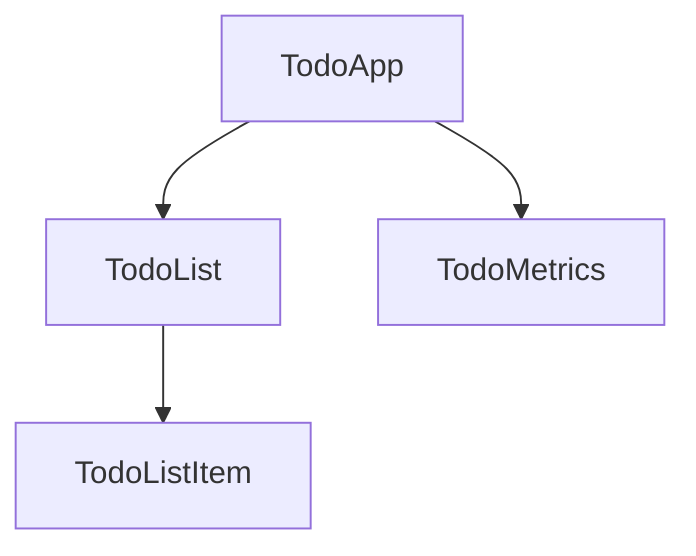

<docs-decorative-header title="元件" imgSrc="adev/src/assets/images/components.svg"> <!-- markdownlint-disable-line -->
在 Angular 中建立應用程式的基本建構單位。
</docs-decorative-header>

元件提供結構，讓你能把專案組織成容易理解、職責明確的部分，使程式碼易於維護且可擴展。

以下範例展示如何將一個 Todo 應用程式拆解成一棵元件樹。



在本指南中，我們將了解如何在 Angular 中建立與使用元件。

## 定義元件

每個元件都有下列核心屬性：

1. 一個 `@Component`[裝飾器](https://www.typescriptlang.org/docs/handbook/decorators.html)，其中包含一些設定
2. 一個 HTML 範本，控制要渲染到 DOM 中的內容
3. 一個 [CSS 選擇器](https://developer.mozilla.org/en-US/docs/Learn/CSS/Building_blocks/Selectors)，定義元件在 HTML 中的使用方式
4. 一個 TypeScript 類別，帶有各種行為，例如管理狀態、處理使用者輸入，或從伺服器取得資料。

以下是一個簡化的 `TodoListItem` 元件範例。

```ts
// todo-list-item.component.ts
@Component({
  selector: 'todo-list-item',
  template: `
    <li>(TODO) Read Angular Essentials Guide</li>
  `,
})
export class TodoListItem {
  /* Component behavior is defined in here */
}
```

你還會在元件中看到的其他常見中繼資料包括：

- `standalone: true` — 建議採用、能簡化元件撰寫體驗的做法
- `styles` — 一個字串或字串陣列，包含你想要套用到元件的任何 CSS 樣式

了解這些之後，以下是我們的 `TodoListItem` 元件的更新版本。

```ts
// todo-list-item.component.ts
@Component({
  standalone: true,
  selector: 'todo-list-item',
  template: `
    <li>(TODO) Read Angular Essentials Guide</li>
  `,
  styles: `
    li {
      color: red;
      font-weight: 300;
    }
  `,
})
export class TodoListItem {
  /* Component behavior is defined in here */
}
```

### 將 HTML 與 CSS 分開放在獨立檔案中

對於偏好在獨立檔案中管理其 HTML 與/或 CSS 的團隊，Angular 提供了兩個額外的屬性：`templateUrl` 與 `styleUrl`。

沿用前面的 `TodoListItem` 元件，替代做法如下：

```ts
// todo-list-item.component.ts
@Component({
  standalone: true,
  selector: 'todo-list-item',
  templateUrl: './todo-list-item.component.html',
  styleUrl: './todo-list-item.component.css',
})
export class TodoListItem {
  /* Component behavior is defined in here */
}
```

```html
<!-- todo-list-item.component.html -->
<li>(TODO) Read Angular Essentials Guide</li>
```

```css
// todo-list-item.component.css
li {
  color: red;
  font-weight: 300;
}
```

## 使用元件 {#using-a-component}

元件架構的優點之一，是你的應用程式具有模組性。換句話說，元件可以在其他元件中使用。

若要使用一個元件，你需要：

1. 將元件匯入檔案中
2. 把它加入元件的 `imports` 陣列
3. 在 `template` 中使用元件的選擇器

以下範例展示 `TodoList` 元件如何匯入前面的 `TodoListItem` 元件：

```ts
// todo-list.component.ts
import {TodoListItem} from './todo-list-item.component.ts';

@Component({
  standalone: true,
  imports: [TodoListItem],
  template: `
    <ul>
      <todo-list-item></todo-list-item>
    </ul>
  `,
})
export class TodoList {}
```

## 下一步

現在你已經了解元件在 Angular 中的運作方式，接著來學習如何在應用程式中加入並管理動態資料。

<docs-pill-row>
  <docs-pill title="管理動態資料" href="essentials/managing-dynamic-data" />
</docs-pill-row>
