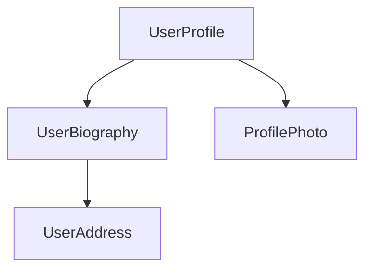

<docs-decorative-header title="元件" imgSrc="adev/src/assets/images/components.svg"> <!-- markdownlint-disable-line -->
在 Angular 中建立應用程式的基本建構單位。
</docs-decorative-header>

元件是 Angular 應用程式的主要建構單位。每個元件代表一個較大網頁的一部分。把應用程式組織成元件，能為專案提供清晰的結構，將程式碼明確區分成各自獨立的部分，方便日後維護與擴展。

## 定義元件

每個元件都由幾個主要部分組成：

1. 一個 `@Component`[裝飾器](https://www.typescriptlang.org/docs/handbook/decorators.html)，其中包含 Angular 所使用的部分設定。
2. 一個 HTML 範本，決定要渲染到 DOM 中的內容。
3. 一個 [CSS 選擇器](https://developer.mozilla.org/docs/Learn/CSS/Building_blocks/Selectors)，定義元件在 HTML 中的使用方式。
4. 一個 TypeScript 類別，包含各種行為，例如處理使用者輸入，或向伺服器發出請求。

以下是一個經過簡化的 `UserProfile` 元件範例。

```angular-ts
// user-profile.ts
@Component({
  selector: 'user-profile',
  template: `
    <h1>User profile</h1>
    <p>This is the user profile page</p>
  `,
})
export class UserProfile { /* Your component code goes here */ }
```

`@Component` 裝飾器也可以選擇性地接受 `styles` 屬性，放入你想套用到範本的任何 CSS：

```angular-ts
// user-profile.ts
@Component({
  selector: 'user-profile',
  template: `
    <h1>User profile</h1>
    <p>This is the user profile page</p>
  `,
  styles: `h1 { font-size: 3em; } `,
})
export class UserProfile { /* Your component code goes here */ }
```

### 將 HTML 與 CSS 分開放在獨立檔案中

你可以使用 `templateUrl` 和 `styleUrl`，把元件的 HTML 與 CSS 定義在個別檔案中：

```angular-ts
// user-profile.ts
@Component({
  selector: 'user-profile',
  templateUrl: 'user-profile.html',
  styleUrl: 'user-profile.css',
})
export class UserProfile {
  // Component behavior is defined in here
}
```

```angular-html
<!-- user-profile.html -->
<h1>User profile</h1>
<p>This is the user profile page</p>
```

```css
/* user-profile.css */
h1 {
  font-size: 3em;
}
```

## 使用元件 {#using-components}

你會把多個元件組合在一起，來建構應用程式。舉例來說，如果你要建立一個使用者個人檔案頁面，你可能會像這樣把頁面拆成幾個元件：



在這個例子中，`UserProfile` 元件使用了其他幾個元件，組合成最終的頁面。

要匯入並使用一個元件，你需要：

1. 在你元件的 TypeScript 檔案中，為要使用的元件加上一個 `import` 陳述式。
2. 在你的 `@Component` 裝飾器中，把要使用的元件加到 `imports` 陣列裡。
3. 在你元件的範本中，加上一個與要使用的元件之選擇器相符的元素。

以下範例展示 `UserProfile` 元件如何匯入 `ProfilePhoto` 元件：

```angular-ts
// user-profile.ts
import {ProfilePhoto} from 'profile-photo.ts';

@Component({
  selector: 'user-profile',
  imports: [ProfilePhoto],
  template: `
    <h1>User profile</h1>
    <profile-photo />
    <p>This is the user profile page</p>
  `,
})
export class UserProfile {
  // Component behavior is defined in here
}
```

TIP: 想更深入了解 Angular 元件嗎？請參閱[元件深入指南](guide/components)，取得完整說明。

## 下一步

現在你已經了解元件在 Angular 中的運作方式，接著來學習如何在應用程式中加入並管理動態資料。

<docs-pill-row>
  <docs-pill title="以訊號實現反應式機制" href="essentials/signals" />
  <docs-pill title="元件深入指南" href="guide/components" />
</docs-pill-row>
