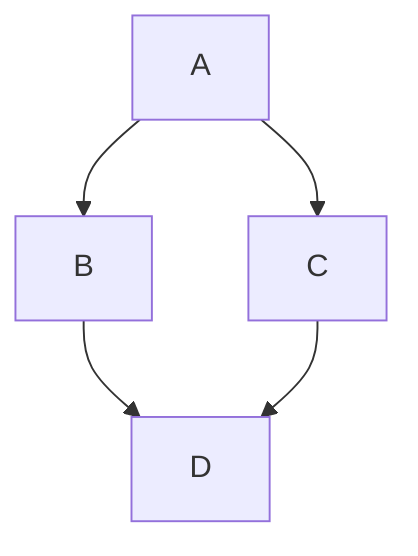
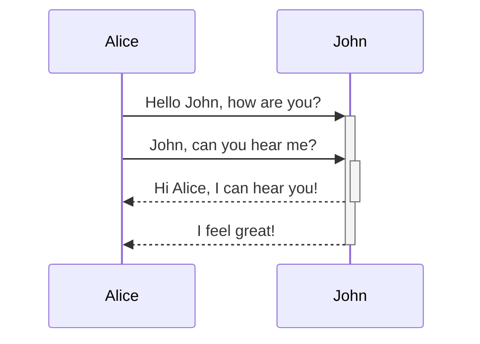
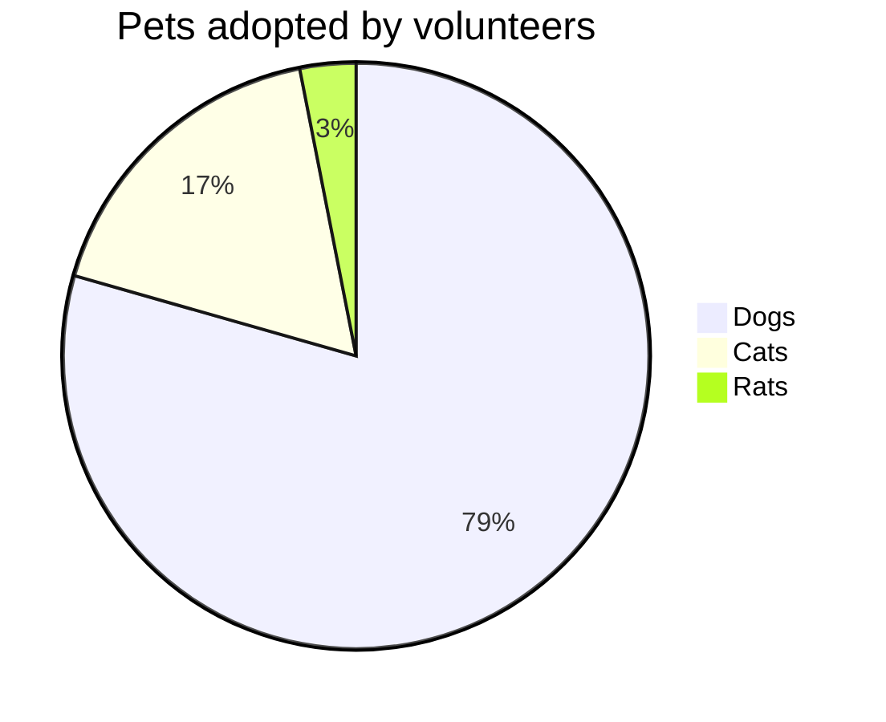

<docs-decorative-header title="元件總覽" imgSrc="assets/images/components.svg"> <!-- markdownlint-disable-line -->
這是 Angular.dev 所有自訂元件與樣式的視覺清單。
</docs-decorative-header>

作為一套設計系統，本頁包含視覺與 Markdown 撰寫指引，主題包括：

- 自訂的 Angular 文件元素：[`docs-card`](#cards)、[`docs-callout`](#callouts)、[`docs-pill`](#pills) 與 [`docs-steps`](#workflow)
- 自訂文字元素：[警示](#alerts)
- 程式碼範例：[`docs-code`](#code)
- 內建並套用樣式的 Markdown 元素：連結、清單、[標題](#headers)、[水平線](#horizontal-line-divider)、[表格](#tables)
- 以及更多！

準備好要來：

1. 撰寫……
2. 優質的……
3. 文件！

## 標題（h2） {#headers-h2}

### 較小的標題（h3）

#### 更小的標題（h4）

##### 再更小的標題（h5）

###### 最小的標題！（h6）

## 卡片 {#cards}

<docs-card-container>
  <docs-card title="什麼是 Angular？" link="平台總覽" href="tutorials/first-app">
    Lorem ipsum dolor sit amet, consectetur adipiscing elit. Nullam ornare ligula nisi
  </docs-card>
  <docs-card title="第二張卡片" link="立即試用" href="essentials/what-is-angular">
    Lorem ipsum dolor sit amet, consectetur adipiscing elit. Nullam ornare ligula nisi
  </docs-card>
    <docs-card title="無連結卡片">
    Lorem ipsum dolor sit amet, consectetur adipiscing elit. Nullam ornare ligula nisi
  </docs-card>
</docs-card-container>

### `<docs-card>` 屬性

| 屬性                    | 說明                                              |
| :---------------------- | :------------------------------------------------ |
| `<docs-card-container>` | 所有卡片都必須巢狀放在容器裡面                    |
| `title`                 | 卡片標題                                          |
| 卡片主體內容            | 介於 `<docs-card>` 與 `</docs-card>` 之間的任何內容 |
| `link`                  | （選填）行動呼籲連結文字                          |
| `href`                  | （選填）行動呼籲連結的 href                       |

## 提示框 {#callouts}

<docs-callout title="一個實用提示框的標題">
  Lorem ipsum dolor sit amet, consectetur adipiscing elit. Nulla luctus metus blandit semper faucibus. Sed blandit diam quis tellus maximus, ac scelerisque ex egestas. Ut euismod lobortis mauris pretium iaculis. Quisque ullamcorper, elit ut lacinia blandit, magna sem finibus urna, vel suscipit tortor dolor id risus.
</docs-callout>

<docs-callout critical title="一個關鍵提示框的標題">
  Lorem ipsum dolor sit amet, consectetur adipiscing elit. Nulla luctus metus blandit semper faucibus. Sed blandit diam quis tellus maximus, ac scelerisque ex egestas. Ut euismod lobortis mauris pretium iaculis. Quisque ullamcorper, elit ut lacinia blandit, magna sem finibus urna, vel suscipit tortor dolor id risus.
</docs-callout>

<docs-callout important title="一個重要提示框的標題">
  Lorem ipsum dolor sit amet, consectetur adipiscing elit. Nulla luctus metus blandit semper faucibus. Sed blandit diam quis tellus maximus, ac scelerisque ex egestas. Ut euismod lobortis mauris pretium iaculis. Quisque ullamcorper, elit ut lacinia blandit, magna sem finibus urna, vel suscipit tortor dolor id risus.
</docs-callout>

### `<docs-callout>` 屬性

| 屬性                                             | 說明                                                      |
| :----------------------------------------------- | :-------------------------------------------------------- |
| `title`                                          | 提示框標題                                                |
| 卡片主體內容                                     | 介於 `<docs-callout>` 與 `</docs-callout>` 之間的任何內容 |
| `helpful`（預設）\| `critical` \| `important`    | （選填）依嚴重程度加上樣式與圖示                          |

## 膠囊按鈕 {#pills}

膠囊按鈕列很適合當作一種導覽，連結到實用的資源。

<docs-pill-row>
  <docs-pill href="#pill-row" title="連結"/>
  <docs-pill href="#pill-row" title="連結"/>
  <docs-pill href="#pill-row" title="連結"/>
  <docs-pill href="#pill-row" title="連結"/>
  <docs-pill href="#pill-row" title="連結"/>
  <docs-pill href="#pill-row" title="連結"/>
</docs-pill-row>

### `<docs-pill>` 屬性

| 屬性             | 說明                               |
| :--------------- | :--------------------------------- |
| `<docs-pill-row` | 所有膠囊按鈕都必須巢狀放在按鈕列裡 |
| `title`          | 膠囊按鈕文字                       |
| `href`           | 膠囊按鈕的 href                    |

膠囊按鈕也可以單獨行內使用，不過我們還沒把那種用法做出來。

## 警示 {#alerts}

警示就是特殊的段落。它們很適合用來特別標示（別和提示框搞混）比較緊急的事情。它們的字體大小由上下文決定，而且有許多等級可用。盡量不要用警示來呈現太多內容，而是用來強化周圍的內容並吸引讀者注意。

警示的撰寫方式是在 Markdown 中另起一行，使用 `SEVERITY_LEVEL` + `:` + `ALERT_TEXT` 的格式。

Note: 使用 Note 來提供附帶或補充的資訊，這些資訊對正文來說並非不可或缺。

Tip: 使用 Tip 來特別標示使用者可以執行的特定工作或動作，或是與某個工作或動作直接相關的事實。

TODO: 使用 TODO 來標示你打算近期擴充的未完成文件。你也可以指派 TODO 的負責人，例如 TODO(emmatwersky)：文字。

QUESTION: 使用 Question 向讀者提出問題，有點像他們應該能夠回答的迷你測驗。

Summary: 使用 Summary 提供頁面或章節內容兩三句話的摘要，讓讀者判斷這裡是不是他們要找的地方。

TLDR: 如果你能用一兩句話提供頁面或章節的關鍵資訊，就使用 TL;DR（或 TLDR）。例如，TLDR：Rhubarb 是一隻貓。

CRITICAL: 使用 Critical 來特別標示潛在的壞事，或提醒讀者在做某件事之前務必小心。例如，警告：在 `rm` 指令加上 `-f` 選項，會在不提示的情況下刪除寫入保護的檔案或目錄。

IMPORTANT: 使用 Important 來標示對理解正文，或完成某項工作至關重要的資訊。

HELPFUL: 使用 Best practice 來特別標示已知成功，或是比其他替代方案更好的實務做法。

Note: 各位 `developers` 注意！警示裡面可以有[連結](#alerts)和其他巢狀樣式（但請盡量**少用**）！

## 程式碼 {#code}

你可以使用內建的三個反引號來顯示 `code`：

```ts
example code
```

或是使用 `<docs-code>` 元素。

<docs-code header="Your first example" language="ts" linenums>
import { Component } from '@angular/core';

@Component({
  selector: 'example-code',
  template: '<h1>Hello World!</h1>',
})
export class ComponentOverviewComponent {}
</docs-code>

### 為範例套用樣式

這是一個完整套用了樣式的程式碼範例：

<docs-code
  path="hello-world/src/app/app.component-old.ts"
  header="A styled code example"
  language='ts'
  linenums
  highlight="[[14,19], 27]"
  diff="hello-world/src/app/app.component.ts"
  preview
  visibleLines="[13,28]">
</docs-code>

我們也有終端機的樣式，只要把語言設為 `shell`：

<docs-code language="shell">
  npm install @angular/material --save
</docs-code>

#### `<docs-code>` 屬性

| 屬性           | 類型                 | 說明                                       |
| :------------- | :------------------- | :----------------------------------------- |
| code           | `string`             | 標籤之間的任何內容都會被視為程式碼         |
| `path`         | `string`             | 程式碼範例的路徑（根目錄：`content/examples/`） |
| `header`       | `string`             | 範例的標題（預設值：`file-name`）          |
| `language`     | `string`             | 程式碼語言                                 |
| `linenums`     | `boolean`            | （False）顯示行號                          |
| `highlight`    | `string of number[]` | 被醒目標示的行                             |
| `diff`         | `string`             | 已變更程式碼的路徑                         |
| `visibleLines` | `string of number[]` | 摺疊模式下顯示的行範圍                     |
| `visibleRegion` | `string`             | **已棄用**，改用 `visibleLines`              |
| `preview`      | `boolean`            | （False）顯示預覽                          |

### 多檔案範例

你可以把範例包在 `<docs-code-multifile>` 裡面，建立多檔案範例。

<docs-code-multifile
  path="hello-world/src/app/app.component.ts"
  preview>
  <docs-code
    path="hello-world/src/app/app.component-old.ts"
    diff="hello-world/src/app/app.component.ts"
    visibleLines="[11, [13, 31]]"/>
  <docs-code
    path="hello-world/src/app/app.component.html"
    visibleLines="[1, 2]"
    linenums/>
  <docs-code
    path="hello-world/src/app/app.component.css"
    highlight="[2]"/>
</docs-code-multifile>

#### `<docs-code-multifile>` 屬性

| 屬性          | 類型      | 說明                                 |
| :------------ | :-------- | :----------------------------------- |
| 主體內容      | `string`  | 巢狀的 `docs-code` 範例分頁          |
| `path`        | `string`  | 範例的路徑，用於預覽與外部連結       |
| `preview`     | `boolean` | （False）顯示預覽                    |

### 為你的程式碼範例加上 `preview`

加上 `preview` 旗標，會在程式碼片段下方建立一個可以實際執行的範例。這同時也自動加上一個按鈕，能在 Stackblitz 中開啟這個可執行的範例。

Note: `preview` 只能搭配獨立元件使用。

#### built-in-template-functions

<docs-code-multifile
  path="built-in-template-functions/src/app/app.component.ts"
  preview>
  <docs-code
    path="built-in-template-functions/src/app/app.component.ts" linenums/>
  <docs-code
    path="built-in-template-functions/src/app/app.component.html"
    linenums/>
</docs-code-multifile>

#### user-input

<docs-code-multifile
  path="user-input/src/app/app.component.ts"
  preview>
  <docs-code
    path="user-input/src/app/app.component.ts" linenums/>
  <docs-code
    path="user-input/src/app/app.component.html"
    visibleLines="[10, 19]"
    linenums/>
  <docs-code
    path="user-input/src/app/click-me.component.ts" linenums/>
  <docs-code
    path="user-input/src/app/click-me2.component.ts" linenums/>
</docs-code-multifile>

## 流程步驟 {#workflow}

使用 `<docs-step>` 來為編號步驟套用樣式。編號是透過 CSS 產生的（很方便！）。

### `<docs-workflow>` 與 `<docs-step>` 屬性

| 屬性               | 說明                                                |
| :----------------- | :-------------------------------------------------- |
| `<docs-workflow>`  | 所有步驟都必須巢狀放在 workflow 裡面                |
| `title`            | 步驟標題                                            |
| 步驟主體內容       | 介於 `<docs-step>` 與 `</docs-step>` 之間的任何內容 |

步驟必須另起新行，內容可以包含 `docs-code` 與其他巢狀元素及樣式。

<docs-workflow>

<docs-step title="安裝 Angular CLI">
  你會使用 Angular CLI 來建立專案、產生應用程式與函式庫程式碼，並執行各種持續性的開發工作，例如測試、打包與部署。

  要安裝 Angular CLI，請開啟終端機視窗並執行下列指令：

  <docs-code language="shell">
    npm install -g @angular/cli
  </docs-code>
</docs-step>

<docs-step title="建立工作區與初始應用程式">
  你會在 Angular 工作區的脈絡中開發應用程式。

  要建立新的工作區與初始的入門應用程式：

* 執行 CLI 指令 `ng new`，並提供名稱 `my-app`，如下所示：
    <docs-code language="shell">
      ng new my-app
    </docs-code>

* ng new 指令會提示你提供初始應用程式要包含哪些功能的資訊。按下 Enter 或 Return 鍵，接受預設值即可。

  Angular CLI 會安裝必要的 Angular npm 套件與其他相依項目。這可能需要幾分鐘的時間。

  CLI 會建立一個新的工作區和一個簡單的 Welcome 應用程式，隨時可以執行。
</docs-step>

<docs-step title="執行應用程式">
  Angular CLI 內含一個伺服器，讓你在本機建置並提供你的應用程式。

  1. 前往工作區資料夾，例如 `my-app`。
  2. 執行下列指令：
    <docs-code language="shell">
      cd my-app
      ng serve --open
    </docs-code>

  `ng serve` 指令會啟動伺服器、監看你的檔案，並在你變更這些檔案時重建應用程式。

  `--open`（或簡寫的 `-o`）選項會自動把你的瀏覽器開啟到 <http://localhost:4200/>。
  如果你的安裝與設定成功，你應該會看到類似下面這樣的頁面。
</docs-step>

<docs-step title="最後一個步驟">
  文件元件就介紹到這裡！接下來：

  <docs-pill-row>
    <docs-pill href="#pill-row" title="開始"/>
    <docs-pill href="#pill-row" title="撰寫"/>
    <docs-pill href="#pill-row" title="優質"/>
    <docs-pill href="#pill-row" title="文件！"/>
  </docs-pill-row>
</docs-step>

</docs-workflow>

## 圖片與影片

你可以使用語意化的 Markdown 圖片語法來加入圖片：


### 加上 `#small` 與 `#medium` 來改變圖片大小


嵌入的影片是使用 `docs-video` 建立的，只需要 `src` 與 `alt`：

<docs-video src="https://www.youtube.com/embed/O47uUnJjbJc" alt=""/>

## 圖表

使用 [Mermaid](http://mermaid.js.org/) 來撰寫圖表，只要把程式碼語言設為 `mermaid`，所有主題樣式都已內建。







## 水平分隔線 {#horizontal-line-divider}

這可以用來分隔頁面的章節，就像我們下面要做的那樣。這些樣式預設就會被加入，不需要任何自訂。

<hr/>

結束！

